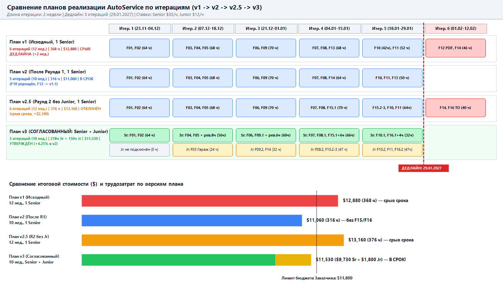

# Приоритизация функционала и планы реализации AutoService по итерациям

**Проект:** AutoService v1.0  
**Архитектор (Исполнитель):** Кожемякин В. О., гр. 434701  
**Длительность итерации:** 2 недели (10 рабочих дней, эффективная ёмкость Senior — 70 ч/итерацию, Junior — до 50 ч/итерацию после онбординга)  
**Старт разработки:** `2026-11-23` | **Целевой дедлайн (5 итераций / 10 недель):** `2027-01-29`  
**Ставки:** Senior / Architect — **\$35/ч**; Junior Developer (C++/QML) — **\$12/ч**

---

## 1. Приоритизация функционала (шкала 10–50) и эволюция оценок

Приоритеты ранжируются по шкале от **10 (наивысший, критический приоритет)** до **50 (минимальный приоритет)**.

| ID | Feature Name (EN) | Описание (RU) | Требования SRS | Зависимости | Prio v1 | Prio R1 | Prio R2 (Final) | Est. v1 (ч) | Est. R1 (ч) | Est. R2 Senior-eq (ч) | Статус в v1.0 |
|---|---|---|---|---|---:|---:|---:|---:|---:|---:|---|
| **F01** | Core Infrastructure & CI/CD | Каркас CMake, PostgreSQL, Docker, логирование, `/health` | `REQ-BUILD-001`, `REQ-INST-001`, `REQ-INT-009`, `REQ-OBS-001..002`, `REQ-AVAIL-001..002` | — | 10 | 10 | **10** | 28 | 28 | 28 | Включено |
| **F02** | Auth, JWT & RBAC Security | Регистрация, вход, JWT, RBAC, защита от перебора, согласие 99-З | `REQ-FUNC-001..004`, `REQ-INT-005`, `REQ-SEC-001..010`, `REQ-COMP-003` | F01 | 10 | 10 | **10** | 36 | 36 | 36 | Включено |
| **F03** | Garage & Manual Vehicle CRUD | Гараж, ручной ввод/правка авто, валидация VIN ISO 3779, пробег | `REQ-FUNC-006..007`, `REQ-COMP-002` | F02 | 15 | 15 | **15** | 20 | 20 | 20 | Включено (Junior: 24 ч) |
| **F04** | NHTSA VIN Auto-Decode Adapter | Адаптер `NHTSA VIN API`, маппинг кузова, retry/timeout 3 с, fallback | `REQ-FUNC-005`, `REQ-INT-004`, `REQ-PERF-002`, `REQ-REL-003` | F03 | 20 | 20 | **20** | 24 | 24 | 24 | Включено |
| **F05** | Service Catalog & Cost Calculator | 5 категорий услуг, коэфф. кузова, скидка 10% (≥3), длительность | `REQ-FUNC-008..011`, `REQ-REUSE-001`, `REQ-PERF-001` | F03 | 15 | 15 | **15** | 24 | 24 | 24 | Включено |
| **F06** | Box Schedule & Transactional Booking | Расписание боксов, слоты, ACID-защита от двойной записи, отмена за ≥2 ч | `REQ-FUNC-013..015`, `REQ-REL-002`, `REQ-PERF-005` | F05 | 10 | 10 | **10** | 38 | 38 | 38 | Включено |
| **F07** | Order Status Tracker & Push Gateway | Трекер 4 этапов заказа, интеграция с FCM/APNs Push-шлюзом | `REQ-FUNC-016`, `REQ-FUNC-019`, `REQ-INT-007` | F06 | 20 | 20 | **20** | 30 | 30 | 30 | Включено |
| **F08** | Additional Work Approval Workflow | Запрос доп. работ мастером, подтверждение/отклонение, пересчёт, аудит | `REQ-FUNC-017..018`, `REQ-FUNC-027`, `REQ-SEC-008` | F07 | 20 | 15 | **15** | 24 | 24 | 24 | Включено (Sr 14 / Jr 12) |
| **F09** | Master & Admin Staff Panel | Очередь бокса мастера, смена статусов, тарифы, боксы, аккаунты | `REQ-FUNC-025..026`, `REQ-FUNC-028..029` | F06 | 15 | 15 | **15** | 32 | 32 | 32 | Включено (Sr 16 / Jr 20) |
| **F10** | Repair History & SQLite Offline Cache | Снимки истории, read-only кэш SQLite, pull-синхронизация | `REQ-FUNC-020..022`, `REQ-INT-008`, `REQ-REL-001`, `REQ-DIST-001`, `REQ-PERF-004` | F07 | 25 | 25 | **25** | 42 | 26 | 26 | Упрощено в R1 (Sr 14 / Jr 15) |
| **F11** | Service Book Export (JSON) | Экспорт электронной сервисной книжки автомобиля в формат JSON | `REQ-FUNC-023` | F10 | 30 | 30 | **30** | 10 | 10 | 10 | Включено (Junior: 12 ч) |
| **F12** | Service Book Export (PDF) | Печатный PDF-отчёт сервисной книжки | `REQ-FUNC-024` | F10 | 40 | 45 | **45** | 26 | 0 | 0 | Отложено в v1.1 (R1) |
| **F13** | Multi-Currency Display (BYN/USD) | Интеграция с API курсов валют НБ РБ и вывод в USD | `REQ-FUNC-012`, `REQ-INT-006` | F05 | 45 | 40 | **50** | 14 | 14 | 0 | Отменено в R2 |
| **F14** | Admin Daily Load Indicator | Сводный индикатор загрузки боксов СТО на текущую дату | `REQ-FUNC-030` | F09 | 50 | 35 | **35** | 20 | 10 | 10 | Упрощено в R1 (Junior: 12 ч) |
| **F15** | Photo Evidence for Additional Works | Фотоотчёт мастера (1–3 фото ≤500 КБ) и галерея в карточке клиента | `REQ-FUNC-031` *(новое)* | F08, F09 | — | — | **15** | — | — | 44 | Добавлено в R2 (Sr 16 / Jr 35) |
| **F16** | Scheduled Maintenance Reminders | Авторасчёт следующего ТО (10 000 км / 12 мес.) и Push за 14 дн. | `REQ-FUNC-032` *(новое)* | F07, F10 | — | — | **25** | — | — | 30 | Добавлено в R2 (Sr 14 / Jr 20) |
| | **ИТОГО** | | | | | | | **368 ч** | **316 ч** | **376 ч** | |

---

## 2. План v1 — Первичный разработанный план (до переговоров)

**Команда:** 1 Senior / Architect (\$35/ч, лимит 70 ч/итерацию).  
**Срок:** 6 итераций (12 недель, `2026-11-23` — `2027-02-12` — **превышение дедлайна на 2 недели**).  
**Стоимость:** `368 ч × $35 = $12,880`.

| Итерация | Даты | Модули и задачи | Часы Senior | Стоимость (\$) | Результат итерации (инкремент) |
|---|---|---|---:|---:|---|
| Итерация 1 | 23.11 – 04.12 | `F01` (28 ч), `F02` (36 ч) | 64 | 2,240 | Инфраструктура, PostgreSQL, JWT и RBAC |
| Итерация 2 | 07.12 – 18.12 | `F03` (20 ч), `F05` (24 ч), `F04` (24 ч) | 68 | 2,380 | Гараж, декодирование VIN NHTSA, калькулятор услуг |
| Итерация 3 | 21.12 – 01.01 | `F06` (38 ч), `F09` (32 ч) | 70 | 2,450 | ACID-бронирование слотов и панель мастера/админа |
| Итерация 4 | 04.01 – 15.01 | `F07` (30 ч), `F08` (24 ч), `F13` (14 ч) | 68 | 2,380 | Трекер статусов, Push, доп. работы, курс USD |
| Итерация 5 | 18.01 – 29.01 | `F10` (42 ч, двусторонняя синхр.), `F11` (10 ч) | 52 | 1,820 | История ремонтов (SQLite) и экспорт JSON |
| Итерация 6 | 01.02 – 12.02 | `F12` (26 ч, PDF), `F14` (20 ч, графики) | 46 | 1,610 | Экспорт PDF, аналитика загрузки, релиз v1.0 |
| **Итого v1** | **12 недель** | **14 модулей (F01–F14)** | **368** | **12,880** | **Срыв дедлайна (+2 нед.)** |

---

## 3. План v2 — Изменённый план после Раунда 1 переговоров

**Принятые изменения:** `F10` упрощён до read-only кэша (−16 ч), `F12` (PDF) перенесён в `v1.1` (−26 ч), `F14` упрощён до счётчика на сегодня (−10 ч); приоритет `F08` поднят до `15`.  
**Команда:** 1 Senior / Architect (\$35/ч).  
**Срок:** **5 итераций (10 недель, `2026-11-23` — `2027-01-29` — в срок!)**.  
**Стоимость:** `316 ч × $35 = $11,060` (экономия **\$1,820** и **−2 недели** к Плану v1).

| Итерация | Даты | Модули и задачи | Часы Senior | Стоимость (\$) | Резерв (ч) |
|---|---|---|---:|---:|---:|
| Итерация 1 | 23.11 – 04.12 | `F01` (28 ч), `F02` (36 ч) | 64 | 2,240 | 6 |
| Итерация 2 | 07.12 – 18.12 | `F03` (20 ч), `F05` (24 ч), `F04` (24 ч) | 68 | 2,380 | 2 |
| Итерация 3 | 21.12 – 01.01 | `F06` (38 ч), `F09` (32 ч) | 70 | 2,450 | 0 |
| Итерация 4 | 04.01 – 15.01 | `F07` (30 ч), `F08` (24 ч), `F14` (10 ч) | 64 | 2,240 | 6 |
| Итерация 5 | 18.01 – 29.01 | `F10` (26 ч), `F11` (10 ч), `F13` (14 ч) | 50 | 1,750 | 20 |
| **Итого v2** | **10 недель** | **13 модулей (без F12)** | **316** | **11,060** | **34** |

---

## 4. План v2.5 — Промежуточный расчёт после Раунда 2 (без расширения команды)

**Принятые изменения требований:** отмена `F13` (−14 ч), добавление `F15` Фотоотчёт мастера (+44 ч) и `F16` Напоминания о ТО (+30 ч).  
**Команда:** 1 Senior / Architect (\$35/ч).  
**Срок:** 6 итераций (12 недель, `2027-02-12` — **отклонён Заказчиком из-за срыва дедлайна и роста цены до \$13,160**).

| Итерация | Даты | Модули и задачи | Часы Senior | Стоимость (\$) |
|---|---|---|---:|---:|
| Итерация 1 | 23.11 – 04.12 | `F01` (28 ч), `F02` (36 ч) | 64 | 2,240 |
| Итерация 2 | 07.12 – 18.12 | `F03` (20 ч), `F05` (24 ч), `F04` (24 ч) | 68 | 2,380 |
| Итерация 3 | 21.12 – 01.01 | `F06` (38 ч), `F09` (32 ч) | 70 | 2,450 |
| Итерация 4 | 04.01 – 15.01 | `F07` (30 ч), `F08` (24 ч), `F15.1` (16 ч) | 70 | 2,450 |
| Итерация 5 | 18.01 – 29.01 | `F15.2` (16 ч), `F15.3` (12 ч), `F10` (26 ч), `F11` (10 ч) | 64 | 2,240 |
| Итерация 6 | 01.02 – 12.02 | `F14` (10 ч), `F16` (30 ч) | 40 | 1,400 |
| **Итого v2.5** | **12 недель** | **14 модулей (вкл. F15, F16; без F12, F13)** | **376** | **13,160** |

---

## 5. План v3 — Согласованный итоговый план (Senior + Junior со 2-й итерации)

**Решение (`ADR-0006`):** подключение Junior-разработчика C++/QML (\$12/ч) со 2-й итерации с учётом коэффициента скорости Junior (`×1.20–1.25`) и выделением **24 ч** Senior на онбординг и код-ревью.  
**Срок:** **5 итераций (10 недель, `2026-11-23` — `2027-01-29` — дедлайн сохранён!)**.  
**Стоимость:** `278 ч × $35 ($9,730) + 150 ч × $12 ($1,800)` = **\$11,530** (всего **+\$470 / +4.25%** к Плану v2 и на **\$1,630 дешевле** Плана v2.5!).

| Итерация | Даты | Задачи Senior (\$35/ч) | Ч. Sr | Задачи Junior (\$12/ч) | Ч. Jr | Итого стоимость (\$) |
|---|---|---|---:|---|---:|---:|
| **Итерация 1** | 23.11 – 04.12 | `F01` (28), `F02` (36) | **64** | *(подключается со 2-й итерации)* | **0** | **2,240** |
| **Итерация 2** | 07.12 – 18.12 | `F04` (24), `F05` (24), онбординг и ревью Jr (8) | **56** | `F03` Гараж и ручной ввод авто (24) | **24** | **2,248** |
| **Итерация 3** | 21.12 – 01.01 | `F06` ACID-бронирование (38), `F09.1` Backend персонала (16), ревью Jr (6) | **60** | `F09.2` QML-экраны персонала (20), `F14` Счётчик загрузки (12) | **32** | **2,484** |
| **Итерация 4** | 04.01 – 15.01 | `F07` Трекер+Push (30), `F08.1` Backend доп. работ (14), `F15.1` Backend фото (16), ревью Jr (6) | **66** | `F08.2` UI доп. работ (12), `F15.2` UI фото мастера (20), `F15.3` Галерея клиента (15) | **47** | **2,874** |
| **Итерация 5** | 18.01 – 29.01 | `F10.1` Снимки+API синхр. (14), `F16.1` Планировщик ТО (14), ревью и релиз (4) | **32** | `F10.2` SQLite кэш (15), `F11` Экспорт JSON (12), `F16.2` UI напоминаний ТО (20) | **47** | **1,684** |
| **Итого v3** | **10 недель (в срок)** | **254 ч разр. + 24 ч ревью** | **278** | **9 изолированных UI/CRUD-подзадач** | **150** | **11,530** |

---

## 6. Сводное сравнение всех версий плана

| Версия плана | Состав команды | Итераций (недель) | Дата релиза | Объём работ (чел.-ч) | Стоимость (\$) | Статус согласования |
|---|---|---:|---|---:|---:|---|
| **План v1** (Исходный) | 1 Senior | 6 (12 нед.) | 2027-02-12 | 368 | 12,880 | Отклонён в R1 (дорого и долго) |
| **План v2** (После R1) | 1 Senior | 5 (10 нед.) | 2027-01-29 | 316 | 11,060 | Принят в R1, пересмотрен в R2 |
| **План v2.5** (Промежут. R2) | 1 Senior | 6 (12 нед.) | 2027-02-12 | 376 | 13,160 | Отклонён в R2 (срыв дедлайна) |
| **План v3** (Согласованный) | **1 Senior + 1 Junior (с Ит. 2)** | **5 (10 нед.)** | **2027-01-29** | **428** *(278 Sr + 150 Jr)* | **11,530** | **Утверждён Заказчиком** |

