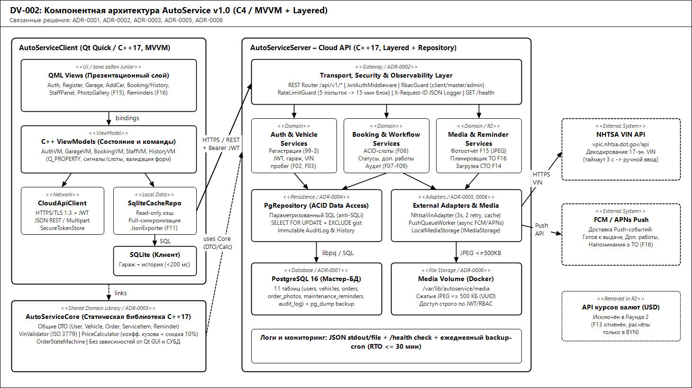
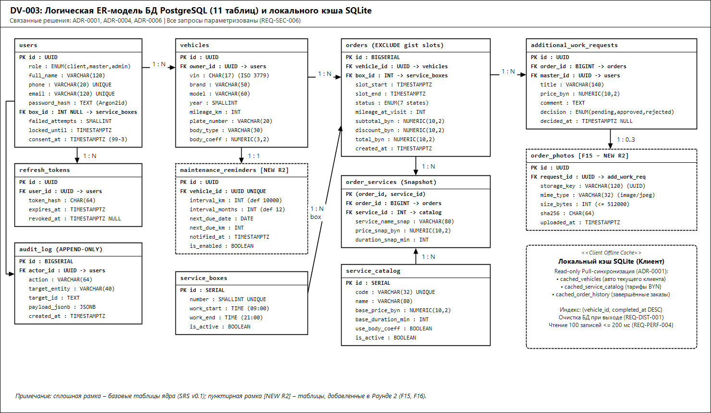
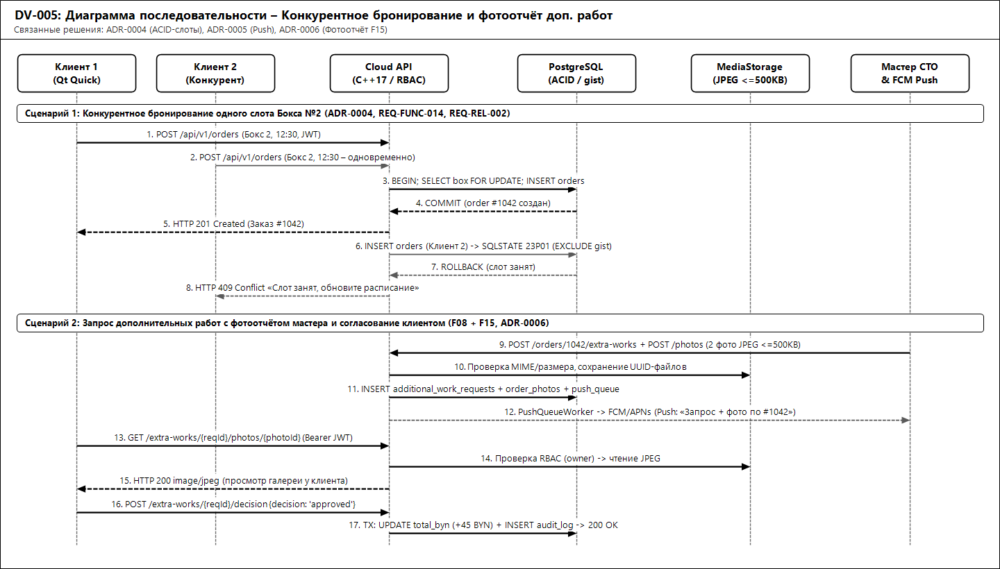
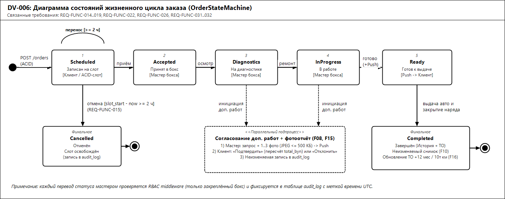
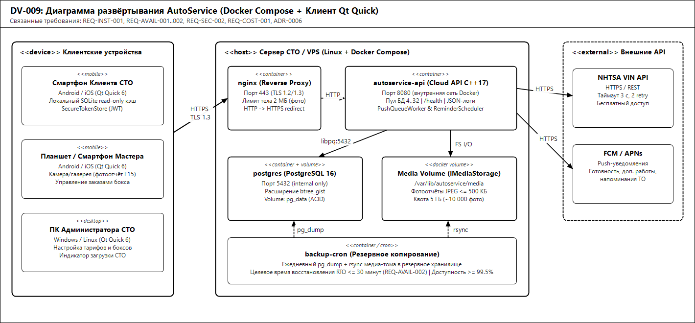

# Описание дизайна программного обеспечения

Для AutoService

Версия 1.0

Подготовил Кожемякин В. О., гр. 434701

БГУИР, ФКСиС, кафедра ЭВМ

2026-11-20

## Оглавление

<!-- TOC -->
* [1. Введение](#1-introduction)
  * [1.1 Назначение документа](#11-document-purpose)
  * [1.2 Область применения](#12-subject-scope)
  * [1.3 Определения, акронимы и сокращения](#13-definitions-acronyms-and-abbreviations)
  * [1.4 Ссылки](#14-references)
  * [1.5 Обзор документа](#15-document-overview)
* [2. Обзор дизайна](#2-design-overview)
  * [2.1 Задачи стейкхолдеров](#21-stakeholder-concerns)
  * [2.2 Выбранные точки зрения](#22-selected-viewpoints)
    * [2.2.1 Контекст](#221-context)
    * [2.2.2 Композиция](#222-composition)
    * [2.2.3 Логическое представление](#223-logical)
    * [2.2.4 Физическое представление](#224-physical)
    * [2.2.5 Структура](#225-structure)
    * [2.2.6 Зависимости](#226-dependency)
    * [2.2.7 Информация](#227-information)
    * [2.2.8 Интерфейс](#228-interface)
    * [2.2.9 Взаимодействие](#229-interaction)
    * [2.2.10 Алгоритм](#2210-algorithm)
    * [2.2.11 Динамика состояний](#2211-state-dynamics)
    * [2.2.12 Параллелизм](#2212-concurrency)
    * [2.2.13 Паттерны](#2213-patterns)
    * [2.2.14 Развёртывание](#2214-deployment)
    * [2.2.15 Ресурсы](#2215-resources)
* [3. Проектные представления](#3-design-views)
* [4. Решения](#4-decisions)
* [5. Приложения](#5-appendixes)
<!-- TOC -->

## История изменений

| Name | Date | Reason For Changes | Version |
|------|------|--------------------|---------|
| Кожемякин В. О. | 2026-11-18 | Первоначальное описание архитектуры SDD по итогам SRS v0.1 и ADR-0001..0005 | 0.1 |
| Кожемякин В. О. | 2026-11-19 | Корректировка после Раунда 1 переговоров: read-only SQLite кэш (`F10`), перенос PDF (`F12`) в v1.1, упрощение счётчика загрузки (`F14`) | 0.2 |
| Кожемякин В. О. | 2026-11-20 | Согласованная версия после Раунда 2: отмена валют USD (`F13`), добавление фотоотчёта (`F15`) и напоминаний о ТО (`F16`), `ADR-0006`, План v3 (Senior + Junior) | 1.0 |

---

## 1. Введение {#1-introduction}

Настоящий документ представляет собой описание проектирования программного обеспечения (**Software Design Description, SDD**) для клиент-серверной системы автосервиса **AutoService** (релиз v1.0). В отличие от спецификации требований (`SRS`), описывающей **что** должна делать система, данный документ фиксирует **как** система будет построена: её архитектурные представления, компоненты, схему данных, программные интерфейсы, алгоритмы и обоснованные проектные решения.

### 1.1 Назначение документа {#11-document-purpose}

Документ служит практическим руководством для команды разработки (Архитектора / Senior-разработчика и подключаемого Junior-разработчика C++/QML), специалистов по тестированию и преподавателя при реализации, интеграции и сопровождении системы **AutoService**. Он обеспечивает сквозную трассируемость от согласованных требований в [srs/srs.md](../srs/srs.md) к проектным представлениям (`DV-001`–`DV-009`), протоколам архитектурных решений в [adr/](../adr/) и календарному плану итераций в [sdd/planning.md](planning.md).

### 1.2 Область применения {#12-subject-scope}

Проектируемая система – **AutoService v1.0** – предназначена для автоматизации записи клиентов на СТО, расчёта стоимости услуг, контроля хода ремонта в боксах, согласования дополнительных работ и ведения электронной сервисной книжки (бизнес-цели `BG01`–`BG05`).

В область проектирования релиза **v1.0** (с учётом итогов двух раундов переговоров с Заказчиком) **входят**:
- кроссплатформенный мобильный клиент на `C++17 / Qt Quick (QML)` с локальным read-only кэшем `SQLite`;
- общая статическая библиотека доменной логики `AutoServiceCore` (валидация VIN, расчёт стоимости и скидок);
- серверное приложение `Cloud API` (`C++17`, REST/JSON поверх HTTPS/TLS 1.3) с аутентификацией `JWT` и ролевым доступом `RBAC`;
- реляционная база данных `PostgreSQL` и защищённое локальное хранилище медиафайлов (`IMediaStorage`) для фотоотчётов мастера (`F15`);
- интеграции с `NHTSA VIN API` и сервисом Push-уведомлений (`FCM / APNs`), а также планировщик напоминаний о плановом ТО (`F16`);
- экспорт сервисной книжки в `JSON` (`F11`) и оперативный счётчик загрузки СТО (`F14`).

В область релиза **v1.0 не входят**:
- онлайн-эквайринг банковских карт, складской учёт запчастей и диагностика `OBD-II` (исключены на уровне SRS);
- экспорт сервисной книжки в `PDF` (`F12`, `REQ-FUNC-024`) – перенесён в релиз `v1.1` по итогам Раунда 1 переговоров;
- отображение эквивалента стоимости в `USD` через API курсов валют (`F13`, `REQ-INT-006`, `REQ-FUNC-012`) – отменено Заказчиком в Раунде 2 по требованиям расчётов в BYN.

### 1.3 Определения, акронимы и сокращения {#13-definitions-acronyms-and-abbreviations}

| Term | Definition |
|------|------------|
| ACID | Atomicity, Consistency, Isolation, Durability – свойства надёжной транзакции СУБД |
| ADR | Architecture Decision Record – протокол значимого архитектурного решения (формат MADR) |
| API | Application Programming Interface – программный интерфейс взаимодействия компонентов |
| BYN | Белорусский рубль – единственная расчётная валюта системы AutoService v1.0 |
| C4 | Context, Containers, Components, Code – модель визуализации архитектуры ПО |
| DTO | Data Transfer Object – структура данных для передачи между слоями и по сети |
| JWT | JSON Web Token – подписанный токен аутентификации (access 30 мин, refresh 14 дн.) |
| MADR | Markdown Architectural Decision Records – шаблон фиксации ADR в Markdown |
| MVVM | Model-View-ViewModel – архитектурный паттерн разделения UI и бизнес-логики в Qt Quick |
| NHTSA | National Highway Traffic Safety Administration – внешний REST-сервис декодирования VIN |
| RBAC | Role-Based Access Control – ролевой контроль доступа (`client`, `master`, `admin`) |
| REST | Representational State Transfer – архитектурный стиль HTTP/JSON API |
| SDD | Software Design Description – документ описания архитектуры и дизайна ПО (IEEE 1016) |
| SQLite | Встраиваемая локальная СУБД мобильного клиента для read-only оффлайн-кэша |
| SRS | Software Requirements Specification – спецификация требований к ПО (ISO/IEC/IEEE 29148) |
| VIN | Vehicle Identification Number – 17-символьный номер автомобиля (ISO 3779) |

### 1.4 Ссылки {#14-references}

1. **IEEE Std 1016-2009** – *Systems and software engineering – Software design description* (нормативный стандарт структуры SDD).
2. **ISO/IEC/IEEE 42010:2011** – *Systems and software engineering – Architecture description* (нормативный стандарт точек зрения и представлений).
3. **ISO/IEC/IEEE 29148:2018** – *Systems and software engineering – Life cycle processes – Requirements engineering* (нормативный стандарт SRS).
4. **Спецификация требований к ПО AutoService (версия 0.2)** – [`srs/srs.md`](../srs/srs.md), 2026-11-20 (нормативный источник требований `REQ-*`).
5. **Протоколы архитектурных решений (ADR-0001..0006)** – каталог [`adr/`](../adr/), 2026-11-20 (нормативные проектные решения).
6. **Переписка с Заказчиком и планы итераций** – [`sdd/negotiations.md`](negotiations.md) и [`sdd/planning.md`](planning.md), 2026-11-20 (справочные артефакты планирования).
7. **Шаблон SDD учебного репозитория** – `sdd/sdd-template.md`, кафедра ЭВМ, БГУИР, 2026 (нормативный шаблон документа).

### 1.5 Обзор документа {#15-document-overview}

Раздел 1 определяет границы, терминологию и нормативные ссылки дизайна. Раздел 2 раскрывает задачи заинтересованных сторон и выбор точек зрения (Viewpoints) стандарта ISO 42010. Раздел 3 содержит девять детализированных проектных представлений (`DV-001`–`DV-009`) с диаграммами, контрактами API, ER-схемой, конечным автоматом и ссылками на требования SRS. Раздел 4 обобщает шесть принятых архитектурных решений (`ADR-0001`–`ADR-0006`). Раздел 5 включает таблицу приоритетов функционала (10–50) и матрицу сквозной трассируемости `SRS ↔ SDD ↔ ADR ↔ Итерация`.

---

## 2. Обзор дизайна {#2-design-overview}

Архитектура **AutoService** строится по принципу клиент-серверного разделения ответственности с выделением переиспользуемого доменного ядра (`AutoServiceCore`), строгой серверной валидацией бизнес-правил и изоляцией внешних интеграций.

### 2.1 Задачи стейкхолдеров {#21-stakeholder-concerns}

| Стейкхолдер | Ключевые задачи и интересы | Адресующие точки зрения / представления |
|---|---|---|
| **Заказчик (Голуб А. В., гр. 434701)** | Соблюдение дедлайна `2027-01-29` и бюджета ≤ \$11,800; исключение двойных записей; рост согласований доп. работ за счёт фотоотчёта; возврат клиентов на ТО | Context (`DV-001`), Interaction (`DV-005`), State Dynamics (`DV-006`), Concurrency (`DV-008`), План v3 |
| **Клиент СТО (Автовладелец)** | Быстрое добавление авто по VIN, прозрачный расчёт в BYN, оффлайн-доступ к истории ремонтов, наглядный фотоотчёт доп. работ, защита ПДн | Context (`DV-001`), Interface (`DV-004`), Algorithm (`DV-007`), Information (`DV-003`) |
| **Мастер и Администратор СТО** | Удобное управление заказами своего бокса, загрузка фото в 2 касания, оперативное обновление тарифов и индикатор загрузки СТО | Interface (`DV-004`), State Dynamics (`DV-006`), Interaction (`DV-005`) |
| **Архитектор / Senior-разработчик** | Чёткие границы слоёв, воспроизводимая сборка CMake, переиспользуемость доменной логики, безопасность делегирования задач Junior | Composition (`DV-002`), Structure & Dependency (`DV-002`), Patterns (`ADR-0003`), Deployment (`DV-009`) |
| **Junior-разработчик (C++/QML)** | Однозначные контракты REST API и ViewModel, изолированные экраны без риска затронуть ACID-логику и безопасность | Composition (`DV-002`), Interface (`DV-004`), Algorithm (`DV-007`) |
| **Преподаватель / QA** | Сквозная трассируемость `REQ-* ↔ DV-* ↔ ADR-*`, проверяемость нефункциональных ограничений, соответствие стандартам IEEE 1016 / ISO 42010 | Все представления (`DV-001`–`DV-009`), Раздел 4, Матрица трассируемости (Раздел 5.2) |

### 2.2 Выбранные точки зрения {#22-selected-viewpoints}

Ниже определены точки зрения стандарта ISO/IEC/IEEE 42010, отобранные для документирования **AutoService v1.0** с указанием их роли и применяемой нотации.

#### 2.2.1 Контекст {#221-context}
**Статус:** выбрана (представление `DV-001`).  
**Адресует:** границы системы AutoService, внешние акторы (Клиент, Мастер, Администратор) и внешние системы (`NHTSA VIN API`, `FCM / APNs`).  
**Язык:** контекстная диаграмма SysMLv2 / C4 Context.

#### 2.2.2 Композиция {#222-composition}
**Статус:** выбрана (представление `DV-002`).  
**Адресует:** декомпозицию на подсистемы (`AutoServiceCore`, `Qt Quick Client`, `Cloud API`, `PostgreSQL`, `SQLite`, `IMediaStorage`) и распределение зон ответственности между Senior и Junior.  
**Язык:** диаграмма контейнеров и компонентов C4 (`sdd/images/arch-components.png`).

#### 2.2.3 Логическое представление {#223-logical}
**Статус:** выбрана (объединено с `DV-002` и `DV-003`).  
**Адресует:** ключевые доменные типы (`User`, `Vehicle`, `ServiceItem`, `ServiceBox`, `Order`, `AdditionalWorkRequest`, `OrderPhoto`, `MaintenanceReminder`) и контракты сервисов.  
**Язык:** описание доменных структур C++17 и ER-модель.

#### 2.2.4 Физическое представление {#224-physical}
**Статус:** частично выбрана (объединена с точкой зрения Развёртывания в `DV-009`).  
**Адресует:** физическое размещение клиентских смартфонов/ПК и серверного хоста СТО с контейнерами и дисковым томом медиафайлов.  
**Язык:** диаграмма узлов развёртывания (`sdd/images/deployment.png`).

#### 2.2.5 Структура {#225-structure}
**Статус:** выбрана (отражена в `DV-002`).  
**Адресует:** внутреннюю композицию мобильного клиента (слои QML Views → C++ ViewModels → Repositories) и сервера Cloud API (HTTP Router → RBAC Middleware → Domain Services → Persistence/Adapters).  
**Язык:** компонентная схема с направленными портами.

#### 2.2.6 Зависимости {#226-dependency}
**Статус:** выбрана (отражена в `DV-002` и `sdd/planning.md`).  
**Адресует:** направленные зависимости модулей сборки CMake (`Client → Core`, `Server → Core`) и граф зависимостей функциональных модулей `F01`–`F16` для планирования итераций.  
**Язык:** граф зависимостей компонентов и таблица зависимостей бэклога.

#### 2.2.7 Информация {#227-information}
**Статус:** выбрана (представление `DV-003`).  
**Адресует:** реляционную схему данных PostgreSQL (11 таблиц), схему read-only кэша SQLite, ссылочную целостность, неизменяемость снимков истории и аудита.  
**Язык:** логическая ER-диаграмма (`sdd/images/er-database.png`).

#### 2.2.8 Интерфейс {#228-interface}
**Статус:** выбрана (представление `DV-004`).  
**Адресует:** строгие HTTP/JSON-контракты REST Cloud API `/api/v1/...`, заголовки JWT, правила RBAC и коды ошибок, позволяющие Junior и Senior работать параллельно.  
**Язык:** табличная спецификация REST-интерфейсов.

#### 2.2.9 Взаимодействие {#229-interaction}
**Статус:** выбрана (представление `DV-005`).  
**Адресует:** рантайм-последовательность критических сценариев: конкурентное бронирование слота и согласование доп. работ с загрузкой фотоотчёта и Push-оповещением.  
**Язык:** диаграмма последовательности UML (`sdd/images/seq-booking-extra.png`).

#### 2.2.10 Алгоритм {#2210-algorithm}
**Статус:** выбрана (представление `DV-007`).  
**Адресует:** детерминированные алгоритмы расчёта стоимости (`PriceCalculator`), валидации VIN по ISO 3779 (`VinValidator`) и планирования напоминаний о ТО.  
**Язык:** псевдокод и математические формулы.

#### 2.2.11 Динамика состояний {#2211-state-dynamics}
**Статус:** выбрана (представление `DV-006`).  
**Адресует:** жизненный цикл заказа `Order`, допустимые переходы ролей, защитные условия (отмена за ≥ 2 ч) и побочные эффекты (освобождение слота, Push, создание напоминания о ТО).  
**Язык:** диаграмма конечного автомата UML (`sdd/images/state-order.png`).

#### 2.2.12 Параллелизм {#2212-concurrency}
**Статус:** выбрана (представление `DV-008`).  
**Адресует:** синхронизацию одновременных запросов бронирования одного бокса (`SELECT ... FOR UPDATE` + `EXCLUDE USING gist`) и потокобезопасность фоновых воркеров Push/ТО.  
**Язык:** описание транзакционного протокола и SQL-ограничений.

#### 2.2.13 Паттерны {#2213-patterns}
**Статус:** выбрана (интегрирована в `DV-002` и `ADR-0001`–`ADR-0006`).  
**Адресует:** повторно используемые архитектурные паттерны: `MVVM` (клиент), `Layered Architecture + Repository` (сервер), `Adapter + Retry + Fallback` (внешние API), `Outbox / Async Worker` (Push).  
**Язык:** архитектурные записи MADR и диаграмма компонентов.

#### 2.2.14 Развёртывание {#2214-deployment}
**Статус:** выбрана (представление `DV-009`).  
**Адресует:** контейнеризацию через Docker Compose (Nginx TLS 1.3, Cloud API, PostgreSQL, том медиа, cron бэкапов) и поставку клиента Qt Quick.  
**Язык:** диаграмма развёртывания UML (`sdd/images/deployment.png`).

#### 2.2.15 Ресурсы {#2215-resources}
**Статус:** выбрана (интегрирована в `DV-009`).  
**Адресует:** пул соединений PostgreSQL, лимиты таймаутов NHTSA (3 с), квоты и сжатие фотоотчётов (≤ 500 КБ, ≤ 3 шт./запрос), объём локального кэша SQLite.  
**Язык:** таблица бюджетов и квот ресурсов.

---

## 3. Проектные представления {#3-design-views}

### DV-001: Контекстное представление системы

- **ID:** `DV-001`
- **Title:** Контекстное представление системы AutoService v1.0
- **Viewpoint:** Контекст (2.2.1)
- **Representation:** Система **AutoService** взаимодействует с тремя ролями пользователей (Клиент СТО, Мастер СТО, Администратор СТО) через единый клиент Qt Quick с ролевой маршрутизацией, а также с двумя внешними программными системами (после исключения API курсов валют в Раунде 2):
  1. **NHTSA VIN API** (`HTTPS / REST`) – декодирование 17-символьного VIN при добавлении автомобиля (с резервным ручным вводом);
  2. **Сервис Push-уведомлений (FCM / APNs)** – доставка оповещений о готовности автомобиля, запросах доп. работ с фотоотчётом и напоминаниях о плановом ТО.
  Базовая контекстная схема приведена в [srs/images/system-context.png](../srs/images/system-context.png); актуальный состав внешних узлов отражён на схеме композиции `DV-002`.
- **More Information:** Реализует `REQ-INT-001`, `REQ-INT-004`, `REQ-INT-007`, `REQ-FUNC-001..005`, `REQ-FUNC-019`, `REQ-FUNC-031..032`. Связанные решения: `ADR-0005`, `ADR-0006`.

---

### DV-002: Композиция подсистем, модульная структура и зависимости

- **ID:** `DV-002`
- **Title:** Компонентная архитектура и модульные зависимости AutoService
- **Viewpoint:** Композиция (2.2.2), Структура (2.2.5), Зависимости (2.2.6), Паттерны (2.2.13)
- **Representation:**
  

  Система разделена на три CMake-цели с однонаправленными зависимостями:
  1. **`AutoServiceCore` (статическая библиотека C++17):** общие DTO, `VinValidator` (ISO 3779), `PriceCalculator` (коэффициенты кузова и скидка 10%), `OrderStateMachine`. Не зависит от Qt GUI и СУБД.
  2. **`AutoServiceClient` (Qt Quick / QML + C++17, паттерн MVVM):**
     - *Presentation (QML Views):* экраны `AuthView`, `RegisterView`, `GarageView`, `AddCarView`, `BookingHistoryView`, `StaffPanelView`, `ExtraWorkPhotoDialog`, `MaintenanceReminderCard` (основная зона задач Junior-разработчика);
     - *ViewModels (C++):* `AuthViewModel`, `GarageViewModel`, `BookingViewModel`, `StaffViewModel`, `HistoryViewModel`;
     - *Data Layer:* `CloudApiClient` (`QNetworkAccessManager`, TLS 1.3 + Bearer JWT), `SqliteCacheRepository` (read-only кэш), `SecureTokenStore`, `JsonExporter`.
  3. **`AutoServiceServer` (Cloud API, C++17, слоистая архитектура):**
     - *Transport & Security Layer:* HTTP/REST маршрутизатор `/api/v1/*`, `JwtAuthMiddleware`, `RbacGuard`, `RateLimitGuard` (блокировка после 5 неверных попыток), `RequestIdLogger`;
     - *Domain Services:* `AuthService`, `VehicleService`, `CatalogPricingService`, `BookingService`, `OrderWorkflowService`, `ExtraWorkService`, `ReminderScheduler`;
     - *Infrastructure & Adapters:* `PgRepository` (параметризованные запросы PostgreSQL), `LocalMediaStorage` (`IMediaStorage` с JPEG-сжатием ≤ 500 КБ), `NhtsaVinAdapter` (timeout 3 с + 2 retry), `PushQueueWorker` (FCM/APNs).
- **More Information:** Реализует `REQ-BUILD-001`, `REQ-MAINT-001`, `REQ-REUSE-001`, `REQ-PORT-001`, `REQ-DIST-001`, `REQ-INT-005`, `REQ-INT-008..009`. Связанные решения: `ADR-0001`, `ADR-0002`, `ADR-0003`, `ADR-0005`, `ADR-0006`.

---

### DV-003: Информационное представление (ER-схема PostgreSQL и кэш SQLite)

- **ID:** `DV-003`
- **Title:** Логическая модель данных PostgreSQL и локального кэша SQLite
- **Viewpoint:** Информация (2.2.7), Логическое представление (2.2.3)
- **Representation:**
  

  Серверная база данных `PostgreSQL` состоит из **11 основных таблиц**:
  - `users` (`id`, `role`, `full_name`, `phone UNIQUE`, `email UNIQUE`, `password_hash`, `box_id FK`, `failed_attempts`, `locked_until`, `consent_at`, `is_active`);
  - `refresh_tokens` (`id`, `user_id FK`, `token_hash`, `expires_at`, `revoked_at`);
  - `vehicles` (`id`, `owner_id FK`, `vin CHAR(17)`, `brand`, `model`, `year`, `mileage_km`, `plate_number`, `body_type`, `body_coeff`);
  - `service_catalog` (`id`, `code UNIQUE`, `name`, `base_price_byn`, `base_duration_min`, `use_body_coeff`, `is_active`);
  - `service_boxes` (`id`, `number UNIQUE`, `work_start`, `work_end`, `is_active`);
  - `orders` (`id`, `vehicle_id FK`, `box_id FK`, `slot_start`, `slot_end`, `status`, `mileage_at_visit`, `subtotal_byn`, `discount_byn`, `total_byn`, `created_at`) – с ограничением `EXCLUDE USING gist` по активным слотам;
  - `order_services` (`order_id FK`, `service_id FK`, `service_name_snapshot`, `price_snapshot_byn`, `duration_snapshot_min`) – неизменяемый снимок тарифов на момент заказа (`REQ-FUNC-022`);
  - `additional_work_requests` (`id`, `order_id FK`, `master_id FK`, `title`, `price_byn`, `comment`, `decision`, `decided_at`);
  - `order_photos` *(новое в v1.0, `F15`)* (`id`, `request_id FK`, `storage_key`, `mime_type`, `size_bytes`, `sha256`, `uploaded_at`);
  - `maintenance_reminders` *(новое в v1.0, `F16`)* (`id`, `vehicle_id FK`, `interval_km`, `interval_months`, `next_due_date`, `next_due_km`, `notified_at`, `is_enabled`);
  - `audit_log` (`id`, `actor_id FK`, `action`, `target_entity`, `target_id`, `payload_jsonb`, `created_at`) – только `INSERT`, запрет `UPDATE/DELETE` на уровне роли БД (`REQ-SEC-008`).

  Локальная база `SQLite` клиента содержит 3 read-only кэш-таблицы (`cached_vehicles`, `cached_service_catalog`, `cached_order_history`) с индексом по `(vehicle_id, completed_at DESC)` и очищается при выходе пользователя (`REQ-DIST-001`).
- **More Information:** Реализует `REQ-INT-008..009`, `REQ-FUNC-002`, `REQ-FUNC-007`, `REQ-FUNC-020..022`, `REQ-FUNC-031..032`, `REQ-SEC-001`, `REQ-SEC-006`, `REQ-SEC-008`, `REQ-COMP-002..003`, `REQ-PERF-004`. Связанные решения: `ADR-0001`, `ADR-0004`, `ADR-0006`.

---

### DV-004: Представление программных интерфейсов (Контракт REST Cloud API)

- **ID:** `DV-004`
- **Title:** Спецификация контрактов REST API `/api/v1/`
- **Viewpoint:** Интерфейс (2.2.8)
- **Representation:** Весь обмен выполняется по `HTTPS (TLS 1.2/1.3)` в `UTF-8 JSON`. Защищённые методы требуют `Authorization: Bearer <access_jwt>`. Унифицированный формат ошибки: `{"error": {"code": "...", "message": "...", "request_id": "..."}}`.

| Группа | Метод и путь | Роли RBAC | Назначение и ключевые коды ответа |
|---|---|---|---|
| **Auth** | `POST /api/v1/auth/register` | Public | Регистрация клиента с согласием 99-З (`201`, `400`, `409` дубль, принудительно роль `client`) |
| **Auth** | `POST /api/v1/auth/login` | Public | Вход клиента/персонала (`200` пара JWT, `401`, `429` блок 15 мин после 5 попыток) |
| **Auth** | `POST /api/v1/auth/refresh`, `/logout` | Authenticated | Ротация refresh-токена / отзыв при выходе (`200`, `401`) |
| **Vehicles** | `GET/POST/PATCH/DELETE /api/v1/vehicles[/{id}]` | Client (owner) | CRUD гаража, обновление пробега; запрет удаления с активным заказом (`409`) |
| **Vehicles** | `GET /api/v1/vehicles/decode-vin?vin=...` | Client | Декодирование через NHTSA (≤ 3 с) или `{"fallback_manual": true}` (`200`, `400`) |
| **Catalog** | `GET /api/v1/services`, `POST /api/v1/pricing/quote` | Authenticated | Получение тарифов и расчёт суммы BYN, скидки 10% и длительности (`200`) |
| **Booking** | `GET /api/v1/boxes/slots?date=&duration=` | Client | Карта свободных/занятых слотов по боксам (`200`) |
| **Booking** | `POST /api/v1/orders`, `PATCH /api/v1/orders/{id}/reschedule`, `DELETE /api/v1/orders/{id}` | Client (owner) | ACID-бронирование (`201` / `409 Conflict`), перенос/отмена за ≥ 2 ч (`200` / `422`) |
| **Workflow** | `GET /api/v1/master/orders`, `PATCH /api/v1/orders/{id}/status` | Master (свой бокс) | Очередь бокса и смена статуса + Push при «Готов к выдаче» (`200`, `403`) |
| **Extra Work** | `POST /api/v1/orders/{id}/extra-works` | Master (свой бокс) | Создание запроса доп. работ (`201`) |
| **Photos (F15)** | `POST /api/v1/extra-works/{reqId}/photos` | Master (свой бокс) | Загрузка 1–3 JPEG ≤ 500 КБ (`multipart/form-data`, `201`, `413`, `415`) |
| **Photos (F15)** | `GET /api/v1/extra-works/{reqId}/photos/{photoId}` | Client (owner), Master, Admin | Защищённая выдача фотоотчёта по RBAC (`200 image/jpeg`, `403`, `404`) |
| **Extra Work** | `POST /api/v1/extra-works/{reqId}/decision` | Client (owner) | Подтверждение или отклонение доп. работ с пересчётом суммы (`200`, `409`) |
| **History** | `GET /api/v1/vehicles/{id}/history?since=` | Client (owner) | Pull-синхронизация завершённых заказов для кэша SQLite (`200`) |
| **Reminders (F16)** | `GET/PATCH /api/v1/vehicles/{id}/reminder` | Client (owner) | Просмотр и настройка интервала планового ТО (`200`) |
| **Admin** | `PUT /api/v1/admin/tariffs`, `/boxes`, `POST /api/v1/admin/masters`, `GET /api/v1/admin/load-today` | Admin | Управление тарифами, боксами, аккаунтами мастеров и счётчиком загрузки (`200`, `403`) |
| **Ops** | `GET /health` | Public/Internal | Проверка готовности Cloud API и подключения к PostgreSQL (`200`, `503`) |

- **More Information:** Реализует `REQ-INT-004..005`, `REQ-INT-007`, `REQ-FUNC-001..032`, `REQ-SEC-002..010`, `REQ-OBS-002`. Связанные решения: `ADR-0002`, `ADR-0005`, `ADR-0006`.

---

### DV-005: Представление взаимодействия (Бронирование и фотоотчёт доп. работ)

- **ID:** `DV-005`
- **Title:** Сценарии конкурентного бронирования и согласования доп. работ с фотоотчётом
- **Viewpoint:** Взаимодействие (2.2.9)
- **Representation:**
  

  Диаграмма иллюстрирует два ключевых сквозных сценария:
  1. **Конкурентное бронирование слота:** два клиента одновременно отправляют `POST /api/v1/orders` на один слот бокса №2; транзакция первого клиента получает блокировку `FOR UPDATE`, создаёт заказ (`201 Created`) и фиксирует изменения; второй клиент получает отказ по ограничению пересечения интервалов (`409 Conflict`) с предложением обновить расписание.
  2. **Запрос доп. работ с фотоотчётом (`F08` + `F15`):** мастер прикрепляет 1–3 фотографии неисправности, сервер валидирует MIME-тип и размер ≤ 500 КБ, сохраняет файл через `IMediaStorage` и метаданные в `order_photos`, ставит Push-событие в очередь `FCM/APNs`. Клиент просматривает фотографии через защищённый RBAC-эндпоинт и подтверждает работы; сервер в транзакции обновляет `total_byn` и пишет событие в `audit_log`.
- **More Information:** Реализует `REQ-FUNC-014`, `REQ-FUNC-017..019`, `REQ-FUNC-027`, `REQ-FUNC-031`, `REQ-REL-002`, `REQ-SEC-004`, `REQ-SEC-008`. Связанные решения: `ADR-0004`, `ADR-0005`, `ADR-0006`.

---

### DV-006: Динамика состояний заказа (`Order`)

- **ID:** `DV-006`
- **Title:** Конечный автомат жизненного цикла заказа
- **Viewpoint:** Динамика состояний (2.2.11)
- **Representation:**
  

  Заказ проходит строго регламентированные состояния:
  - `Scheduled` (Записан) → `Cancelled` (Отменён): разрешено клиенту при условии `slot_start - now >= 2 ч` (освобождает слот);
  - `Scheduled` → `Accepted` (Принят в бокс) → `Diagnostics` (На диагностике) → `InProgress` (В работе) → `Ready` (Готов к выдаче): переводы выполняет только Мастер закреплённого бокса с фиксацией времени в `audit_log`;
  - на этапах `Diagnostics` и `InProgress` мастер может инициировать запрос доп. работ с фотоотчётом (не блокирует основной статус, но пересчитывает `total_byn` при подтверждении);
  - переход в `Ready` автоматически ставит в очередь Push-уведомление клиенту;
  - `Ready` → `Completed` (Завершён): фиксирует неизменяемую запись истории для кэша SQLite и автоматически обновляет дату/пробег следующего планового ТО в `maintenance_reminders` (`F16`).
- **More Information:** Реализует `REQ-FUNC-015..019`, `REQ-FUNC-022`, `REQ-FUNC-026`, `REQ-FUNC-031..032`. Связанные решения: `ADR-0004`, `ADR-0006`.

---

### DV-007: Представление алгоритмов (`PriceCalculator`, `VinValidator`, `ReminderScheduler`)

- **ID:** `DV-007`
- **Title:** Ключевые детерминированные алгоритмы доменного ядра AutoServiceCore
- **Viewpoint:** Алгоритм (2.2.10)
- **Representation:**
  1. **Алгоритм расчёта стоимости и длительности (`PriceCalculator::calculate`, сложность $O(n)$, $n \le 5$):**
     ```text
     Input:  selectedServices[], bodyCoeff (1.0 | 1.3 | 1.5), discountPercent (default 10)
     Output: subtotalByn, discountByn, totalByn, totalDurationMin

     subtotalByn = 0; totalDurationMin = 0
     for each s in selectedServices:
         price = s.useBodyCoeff ? round2(s.basePriceByn * bodyCoeff) : s.basePriceByn
         subtotalByn += price
         totalDurationMin += s.baseDurationMin
     discountByn = (selectedServices.size() >= 3) ? round2(subtotalByn * discountPercent / 100.0) : 0.00
     totalByn = round2(subtotalByn - discountByn)
     return {subtotalByn, discountByn, totalByn, totalDurationMin}
     ```
     *Контрольный пример (`REQ-FUNC-009..010`):* Кроссовер (`x1.3`), 3 услуги (Ремонт 180 + Мойка 35×1.3=45.50 + Антикор 250×1.3=325.00) → `subtotal = 550.50 BYN`, скидка 10% = `-55.05 BYN`, итог = `495.45 BYN`.
  2. **Валидация VIN по ISO 3779 (`VinValidator::validate`, сложность $O(1)$):** приведение к верхнему регистру, проверка `length == 17`, регулярное выражение `^[A-HJ-NPR-Z0-9]{17}$` (исключаются `I`, `O`, `Q`).
  3. **Расчёт планового ТО (`ReminderScheduler`, `F16`):** при закрытии заказа (`Completed`) для автомобиля с включённым напоминанием устанавливается `next_due_date = visit_date + interval_months` (по умолчанию 12 мес.) и `next_due_km = mileage_at_visit + interval_km` (по умолчанию 10 000 км). Ежедневная задача в 09:00 UTC находит записи, где `next_due_date - CURRENT_DATE <= 14 days` и `notified_at IS NULL`, и отправляет Push-уведомление с переходом на экран бронирования.
- **More Information:** Реализует `REQ-FUNC-006`, `REQ-FUNC-009..011`, `REQ-FUNC-032`, `REQ-COMP-002`, `REQ-REUSE-001`. Связанные решения: `ADR-0003`, `ADR-0006`.

---

### DV-008: Представление параллелизма и целостности транзакций

- **ID:** `DV-008`
- **Title:** Защита конкурентных операций бронирования и фоновых задач
- **Viewpoint:** Параллелизм (2.2.12)
- **Representation:**
  - **Многопоточность Cloud API:** асинхронный пул рабочих потоков HTTP-сервера с выделенным пулом соединений к PostgreSQL (до 32 активных соединений для ≥ 200 клиентских сессий по `REQ-PERF-005`).
  - **Защита от двойного бронирования (`ADR-0004`):** операция `POST /api/v1/orders` открывает транзакцию `READ COMMITTED`, выполняет `SELECT id FROM service_boxes WHERE id = $1 AND is_active = true FOR UPDATE`, проверяет попадание в рабочие часы и вставляет строку в `orders`. На уровне схемы действует исключающее ограничение:
    ```sql
    ALTER TABLE orders ADD CONSTRAINT no_overlapping_active_orders
    EXCLUDE USING gist (
        box_id WITH =,
        tstzrange(slot_start, slot_end, '[)') WITH &&
    ) WHERE (status <> 'cancelled');
    ```
    При нарушении ограничения (`SQLSTATE 23P01`) транзакция откатывается и клиенту возвращается `409 Conflict`.
  - **Фоновые воркеры:** `PushQueueWorker` (интервал 2 с) и `ReminderScheduler` (1 раз в сутки) используют `SELECT ... FOR UPDATE SKIP LOCKED` для безопасной обработки событий без дублирования Push.
- **More Information:** Реализует `REQ-FUNC-014..015`, `REQ-PERF-001`, `REQ-PERF-005`, `REQ-REL-002`. Связанные решения: `ADR-0004`, `ADR-0005`.

---

### DV-009: Представление развёртывания и управления ресурсами

- **ID:** `DV-009`
- **Title:** Топология развёртывания Docker Compose и бюджет ресурсов
- **Viewpoint:** Развёртывание (2.2.14), Физическое представление (2.2.4), Ресурсы (2.2.15)
- **Representation:**
  

  Серверный контур разворачивается одной командой `docker compose up -d` (`REQ-INST-001`) на хосте СТО (или VPS) и включает:
  1. `nginx` – терминация `HTTPS (TLS 1.2/1.3)`, ограничение размера тела запроса (2 МБ для фото), проксирование на `Cloud API`;
  2. `autoservice-api` – контейнер C++17 `Cloud API` с автоперезапуском `restart: unless-stopped` (`REQ-AVAIL-001`) и примонтированным томом `/var/lib/autoservice/media`;
  3. `postgres` (PostgreSQL 16) – контейнер БД с постоянным томом данных и автоматическим прогоном SQL-миграций при старте;
  4. `backup-cron` – ежедневный `pg_dump` + инкрементальная синхронизация медиа-тома (целевой `RTO <= 30 мин`, `REQ-AVAIL-002`).

  **Таблица бюджетов и квот ресурсов:**

  | Ресурс | Квота / ограничение | Обоснование (требование SRS) |
  |---|---|---|
  | Пул соединений PostgreSQL | min 4, max 32 соединения | 200+ активных сессий, p95 ≤ 300 мс (`REQ-PERF-001`, `REQ-PERF-005`) |
  | Таймаут NHTSA VIN API | 3000 мс, до 2 retry (пауза 300 мс) | Отсутствие зависаний UI (`REQ-PERF-002`, `REQ-REL-003`) |
  | Фотоотчёт мастера (`F15`) | До 3 JPEG/запрос, ≤ 500 КБ/файл | Контроль объёма диска и трафика (`REQ-FUNC-031`, `ADR-0006`) |
  | Локальный кэш SQLite | До 10 МБ на устройстве, read-only | Чтение 100 записей ≤ 200 мс (`REQ-PERF-004`, `REQ-REL-001`) |
  | Доступность сервера | ≥ 99.5% в рабочие часы (08:00–22:00) | Бесперебойная работа боксов СТО (`REQ-AVAIL-001`) |

- **More Information:** Реализует `REQ-INST-001`, `REQ-AVAIL-001..002`, `REQ-OBS-001..002`, `REQ-SEC-002`, `REQ-COST-001`, `REQ-PORT-001`. Связанные решения: `ADR-0001`, `ADR-0005`, `ADR-0006`.

---

## 4. Решения {#4-decisions}

Все значимые архитектурные решения задокументированы в формате **MADR** в каталоге [`adr/`](../adr/). Ниже приведён сводный реестр.

| ID | Заголовок решения | Статус | Ключевой выбор | Связанные SRS / SDD | Файл MADR |
|---|---|---|---|---|---|
| **ADR-0001** | Гибридное хранение PostgreSQL и SQLite | Accepted | PostgreSQL (ACID-мастер) + SQLite (read-only кэш, Pull-only) | `REQ-INT-008..009`, `REQ-REL-001..002` / `DV-003` | [`adr/0001-...md`](../adr/0001-use-postgresql-and-sqlite-hybrid-storage.md) |
| **ADR-0002** | JWT и серверный RBAC | Accepted | Access JWT (30 мин) + Refresh в PostgreSQL (14 дн.) + RBAC middleware | `REQ-INT-005`, `REQ-SEC-001..010` / `DV-004` | [`adr/0002-...md`](../adr/0002-use-jwt-with-rbac-for-authentication.md) |
| **ADR-0003** | MVVM в Qt Quick и библиотека `AutoServiceCore` | Accepted | QML Views + C++ ViewModels + общая библиотека C++17 `AutoServiceCore` | `REQ-MAINT-001`, `REQ-REUSE-001`, `REQ-BUILD-001` / `DV-002`, `DV-007` | [`adr/0003-...md`](../adr/0003-use-qt-quick-mvvm-and-shared-domain-library.md) |
| **ADR-0004** | Защита от двойного бронирования слотов | Accepted | Транзакция PostgreSQL `SELECT ... FOR UPDATE` + `EXCLUDE USING gist` | `REQ-FUNC-014..015`, `REQ-REL-002` / `DV-005`, `DV-008` | [`adr/0004-...md`](../adr/0004-pessimistic-locking-for-slot-booking.md) |
| **ADR-0005** | Отказоустойчивые адаптеры внешних API | Accepted | Паттерн Adapter + timeout 3 с + 2 retry + кэш VIN + асинхронный Push | `REQ-INT-004`, `REQ-INT-007`, `REQ-PERF-002`, `REQ-REL-003` / `DV-002` | [`adr/0005-...md`](../adr/0005-resilient-external-api-adapters.md) |
| **ADR-0006** | Хранение фотоотчётов и подключение Junior | Accepted | Docker volume (`IMediaStorage`, JPEG ≤ 500 КБ) + Junior с Итер. 2 (24 ч ревью Sr) | `REQ-FUNC-031..032`, `REQ-DEAD-001`, `REQ-COST-001` / `DV-003`, `DV-009` | [`adr/0006-...md`](../adr/0006-photo-evidence-storage-and-team-scaling.md) |

---

## 5. Приложения {#5-appendixes}

### 5.1 Приоритизация функционала (шкала 10–50) и планы итераций

Детальная приоритизация всех 16 модулей (`F01`–`F16`) на английском и русском языках с ранжированием от `10` (наивысший) до `50` (минимальный), а также три версии календарного плана (**План v1 – Исходный**, **План v2 – Изменённый после Раунда 1**, **План v2.5 – Промежуточный**, **План v3 – Согласованный с Junior-разработчиком**) приведены в отдельном документе [`sdd/planning.md`](planning.md). Протокол обоих раундов переписки с Заказчиком зафиксирован в [`sdd/negotiations.md`](negotiations.md).

### 5.2 Матрица сквозной трассируемости (`SRS ↔ SDD ↔ ADR ↔ План v3`)

| Группа требований SRS | Модуль (EN) | Приоритет (10–50) | Представления SDD | Решения ADR | Итерация (План v3) | Исполнитель |
|---|---|---:|---|---|---|---|
| `REQ-BUILD-001`, `REQ-INST-001`, `REQ-INT-009`, `REQ-OBS-001..002`, `REQ-AVAIL-001..002` | `F01` Core Infrastructure & CI/CD | 10 | `DV-002`, `DV-003`, `DV-009` | `ADR-0001`, `ADR-0003` | Итерация 1 | Senior |
| `REQ-FUNC-001..004`, `REQ-INT-005`, `REQ-SEC-001..010`, `REQ-COMP-003` | `F02` Auth, JWT & RBAC Security | 10 | `DV-002`, `DV-003`, `DV-004` | `ADR-0002` | Итерация 1 | Senior |
| `REQ-FUNC-006..007`, `REQ-COMP-002`, `REQ-INT-001..003` | `F03` Garage & Manual Vehicle CRUD | 15 | `DV-002`, `DV-003`, `DV-007` | `ADR-0003` | Итерация 2 | Junior (ревью Sr) |
| `REQ-FUNC-005`, `REQ-INT-004`, `REQ-PERF-002`, `REQ-REL-003` | `F04` NHTSA VIN Auto-Decode Adapter | 20 | `DV-001`, `DV-002`, `DV-004` | `ADR-0005` | Итерация 2 | Senior |
| `REQ-FUNC-008..011`, `REQ-REUSE-001`, `REQ-PERF-001` | `F05` Service Catalog & Cost Calculator | 15 | `DV-002`, `DV-004`, `DV-007` | `ADR-0003` | Итерация 2 | Senior |
| `REQ-FUNC-013..015`, `REQ-REL-002`, `REQ-PERF-005` | `F06` Box Schedule & Transactional Booking | 10 | `DV-003`, `DV-005`, `DV-006`, `DV-008` | `ADR-0004` | Итерация 3 | Senior |
| `REQ-FUNC-025..026`, `REQ-FUNC-028..029` | `F09` Master & Admin Staff Panel | 15 | `DV-002`, `DV-004`, `DV-006` | `ADR-0002`, `ADR-0003` | Итерация 3 | Senior + Junior |
| `REQ-FUNC-030` *(упрощён в R1)* | `F14` Admin Daily Load Indicator | 35 | `DV-004` | `ADR-0003` | Итерация 3 | Junior (ревью Sr) |
| `REQ-FUNC-016`, `REQ-FUNC-019`, `REQ-INT-007` | `F07` Order Status Tracker & Push Gateway | 20 | `DV-001`, `DV-005`, `DV-006` | `ADR-0005` | Итерация 4 | Senior |
| `REQ-FUNC-017..018`, `REQ-FUNC-027`, `REQ-SEC-008` | `F08` Additional Work Approval Workflow | 15 | `DV-003`, `DV-005`, `DV-006` | `ADR-0004`, `ADR-0006` | Итерация 4 | Senior + Junior |
| `REQ-FUNC-031` *(новое в R2)* | `F15` Photo Evidence for Additional Works | 15 | `DV-002`, `DV-003`, `DV-004`, `DV-005`, `DV-009` | `ADR-0006` | Итерация 4 | Senior + Junior |
| `REQ-FUNC-020..022`, `REQ-INT-008`, `REQ-REL-001`, `REQ-DIST-001`, `REQ-PERF-004` | `F10` Repair History & SQLite Offline Cache | 25 | `DV-002`, `DV-003`, `DV-004`, `DV-009` | `ADR-0001` | Итерация 5 | Senior + Junior |
| `REQ-FUNC-023` | `F11` Service Book Export (JSON) | 30 | `DV-002`, `DV-003` | `ADR-0001`, `ADR-0003` | Итерация 5 | Junior (ревью Sr) |
| `REQ-FUNC-032` *(новое в R2)* | `F16` Scheduled Maintenance Reminders | 25 | `DV-003`, `DV-004`, `DV-006`, `DV-007` | `ADR-0005`, `ADR-0006` | Итерация 5 | Senior + Junior |
| `REQ-FUNC-024` | `F12` Service Book Export (PDF) | 45 | – | – | Отложено (v1.1) | – |
| `REQ-INT-006`, `REQ-FUNC-012` | `F13` Multi-Currency Display (BYN/USD) | 50 | – | `ADR-0005` | Отменено (R2) | – |
