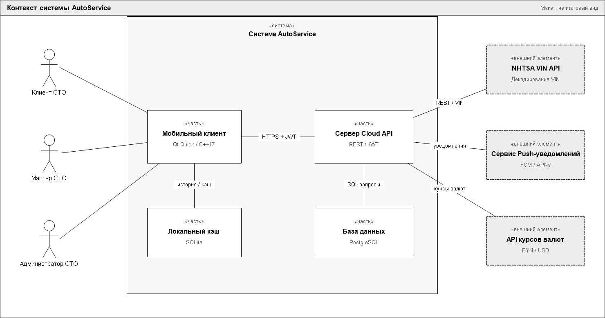
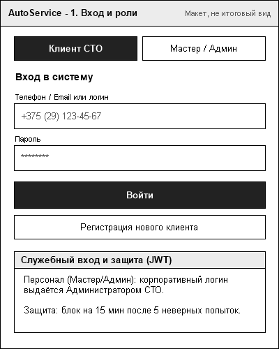
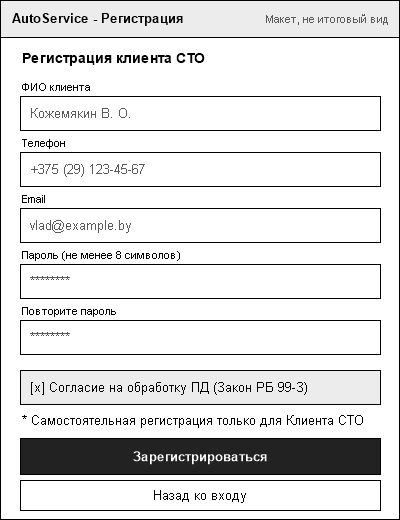
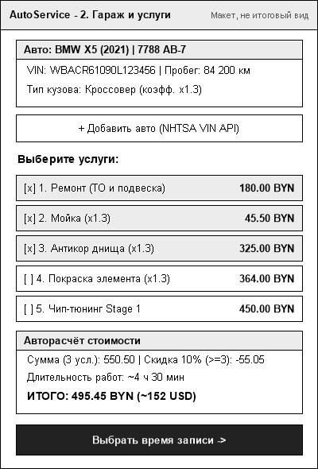
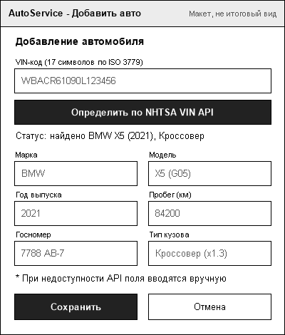
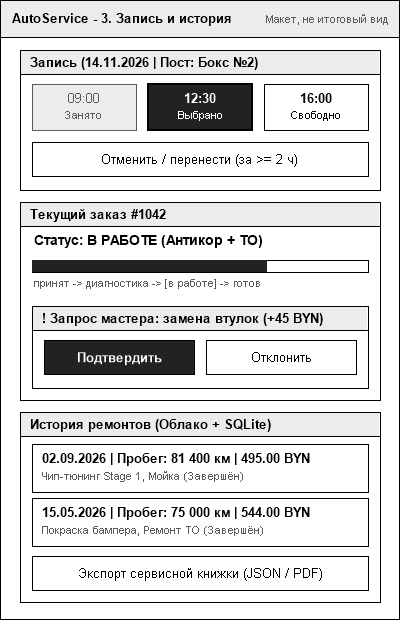
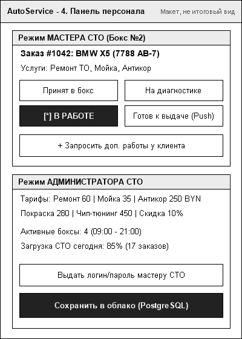

# Спецификация требований к ПО

Для AutoService

Версия 0.1

Подготовил Кожемякин В. О., гр. 434701

БГУИР, ФКСиС, кафедра ЭВМ

2026-11-12

## Оглавление

<!-- TOC -->
* [1. Введение](#1-introduction)
  * [1.1 Назначение документа](#11-document-purpose)
  * [1.2 Область применения продукта](#12-product-scope)
  * [1.3 Определения, акронимы и сокращения](#13-definitions-acronyms-and-abbreviations)
  * [1.4 Ссылки](#14-references)
  * [1.5 Обзор документа](#15-document-overview)
* [2. Обзор продукта](#2-product-overview)
  * [2.1 Перспектива продукта](#21-product-perspective)
  * [2.2 Функции продукта](#22-product-functions)
  * [2.3 Ограничения продукта](#23-product-constraints)
  * [2.4 Характеристики пользователей](#24-user-characteristics)
  * [2.5 Допущения и зависимости](#25-assumptions-and-dependencies)
  * [2.6 Распределение требований](#26-apportioning-of-requirements)
* [3. Требования](#3-requirements)
  * [3.1 Внешние интерфейсы](#31-external-interfaces)
    * [3.1.1 Пользовательские интерфейсы](#311-user-interfaces)
    * [3.1.2 Аппаратные интерфейсы](#312-hardware-interfaces)
    * [3.1.3 Программные интерфейсы](#313-software-interfaces)
  * [3.2 Функциональные требования](#32-functional)
  * [3.3 Качество обслуживания](#33-quality-of-service)
    * [3.3.1 Производительность](#331-performance)
    * [3.3.2 Безопасность](#332-security)
    * [3.3.3 Надёжность](#333-reliability)
    * [3.3.4 Доступность](#334-availability)
    * [3.3.5 Наблюдаемость](#335-observability)
  * [3.4 Соответствие стандартам](#34-compliance)
  * [3.5 Проектирование и реализация](#35-design-and-implementation)
    * [3.5.1 Установка](#351-installation)
    * [3.5.2 Сборка и поставка](#352-build-and-delivery)
    * [3.5.3 Распределение](#353-distribution)
    * [3.5.4 Сопровождаемость](#354-maintainability)
    * [3.5.5 Повторное использование](#355-reusability)
    * [3.5.6 Переносимость](#356-portability)
    * [3.5.7 Стоимость](#357-cost)
    * [3.5.8 Сроки](#358-deadline)
    * [3.5.9 Доказательство концепции](#359-proof-of-concept)
    * [3.5.10 Управление изменениями](#3510-change-management)
  * [3.6 ИИ/МО](#36-aiml)
* [4. Верификация](#4-verification)
* [5. Приложения](#5-appendixes)
<!-- TOC -->

## История изменений

| Name | Date | Reason For Changes | Version |
|------|------|--------------------|---------|
| Кожемякин В. О. | 2026-11-12 | Первоначальная разработка SRS по итогам интервью с Заказчиком | 0.1 |

---

## 1. Введение {#1-introduction}

Настоящий документ представляет собой спецификацию требований к программному обеспечению (SRS) для программной системы **AutoService**, предназначенной для автоматизации взаимодействия клиентов и персонала станции технического обслуживания (СТО). Документ определяет функциональные возможности, интерфейсы, атрибуты качества и ограничения системы на уровне «чёрного ящика» и не содержит детальных проектных решений.

### 1.1 Назначение документа {#11-document-purpose}

Спецификация требований к ПО определяет **что** должна делать система AutoService, но не описывает, **как** это будет реализовано в коде. Документ служит единым согласованным источником истины для Заказчика, разработчиков клиентской и серверной частей, специалистов по обеспечению качества (QA) и преподавателя на всех последующих этапах жизненного цикла ПО. На основе данной спецификации разрабатываются описание архитектуры и проекта (SDD), записи архитектурных решений (ADR), тестовые сценарии и критерии приёмки продукта.

### 1.2 Область применения продукта {#12-product-scope}

Продукт **AutoService (версия 1.0)** — клиент-серверная программная система для СТО, включающая мобильный клиент на Qt Quick (C++17 / QML), серверное приложение Cloud API (C++), локальное хранилище SQLite на клиентском устройстве и серверную СУБД PostgreSQL.

Система решает следующие бизнес-цели:
- **BG01:** Упростить и ускорить процесс записи автовладельцев на СТО за счёт автоопределения автомобиля по VIN и онлайн-бронирования свободных временных слотов.
- **BG02:** Обеспечить прозрачность ценообразования и хода обслуживания (расчёт стоимости с учётом типа кузова и скидок, отображение этапов ремонта и согласование дополнительных работ).
- **BG03:** Сохранять достоверную историю ремонтов и предоставлять электронную сервисную книжку в облаке и оффлайн с возможностью экспорта.
- **BG04:** Автоматизировать работу мастеров и администратора СТО по управлению статусами заказов, тарифами, боксами и правами доступа.
- **BG05:** Обеспечить защиту персональных данных и разграничение полномочий пользователей (RBAC).

В состав первой версии продукта **входят**: регистрация и вход с ролевым доступом, гараж автомобилей с декодированием VIN через NHTSA VIN API, выбор 5 базовых услуг СТО (ремонт/ТО, мойка, антикор, покраска, чип-тюнинг), калькулятор стоимости (BYN/USD), бронирование по боксам и времени, трекер статуса заказа, согласование дополнительных работ, история ремонтов (PostgreSQL + SQLite), экспорт сервисной книжки (JSON/PDF), панель мастера и панель администратора.

В состав продукта **не входят**: онлайн-эквайринг банковских карт и приём оплаты внутри приложения, складской учёт запчастей у внешних поставщиков, бухгалтерский учёт и интеграция с диагностическими OBD-II сканерами.

### 1.3 Определения, акронимы и сокращения {#13-definitions-acronyms-and-abbreviations}

| Term | Definition |
|------|------------|
| API | Application Programming Interface — программный интерфейс взаимодействия между компонентами и внешними сервисами |
| BYN | Белорусский рубль — основная расчётная валюта стоимости услуг в системе |
| JWT | JSON Web Token — подписанный токен аутентификации и авторизации для запросов к Cloud API |
| NHTSA VIN API | Открытый REST API Национального управления безопасностью движения на трассах США для декодирования 17-значного VIN |
| RBAC | Role-Based Access Control — модель управления доступом на основе ролей (Клиент, Мастер СТО, Администратор СТО) |
| REST | Representational State Transfer — архитектурный стиль построения сетевых API поверх протокола HTTPS |
| SRS | Software Requirements Specification — спецификация требований к программному обеспечению |
| SQLite | Встраиваемая локальная реляционная СУБД, используемая мобильным клиентом для оффлайн-кэша истории ремонтов |
| UI | User Interface — графический пользовательский интерфейс мобильного приложения |
| VIN | Vehicle Identification Number — уникальный 17-символьный идентификационный номер транспортного средства (ISO 3779) |
| Бокс (пост) | Специализированное рабочее место на СТО, закреплённое за мастером и имеющее собственное расписание слотов |
| Дополнительные работы | Работы и запчасти, необходимость которых выявлена мастером в ходе диагностики и требующие подтверждения клиента |
| Сервисная книжка | Структурированная история завершённых заказов и пробегов конкретного автомобиля |
| Слот | Интервал времени в расписании конкретного бокса СТО, доступный для записи клиента |

### 1.4 Ссылки {#14-references}

1. **ISO/IEC/IEEE 29148:2018** — *Systems and software engineering — Life cycle processes — Requirements engineering* (нормативный стандарт структуры SRS).
2. **ISO 3779:2009** — *Road vehicles — Vehicle identification number (VIN) — Content and structure* (нормативный формат VIN-номера).
3. **Закон Республики Беларусь от 07.05.2021 № 99-З** — *«О защите персональных данных»* (нормативное требование обработки данных клиентов).
4. **NHTSA vPIC API Documentation** — *https://vpic.nhtsa.dot.gov/api/* (справочная спецификация внешнего сервиса декодирования VIN).
5. **Шаблон SRS учебного репозитория** — `srs/srs-template.md`, кафедра ЭВМ, БГУИР, 2026 (нормативный шаблон документа).
6. **Модели SysMLv2 и макеты интерфейсов** — `srs/models/` и `srs/images/` в данном репозитории (справочные макеты к критериям приёмки).

### 1.5 Обзор документа {#15-document-overview}

Раздел 1 определяет назначение документа, границы продукта, глоссарий и нормативные ссылки. Раздел 2 раскрывает контекст продукта, основные функции, ограничения, классы пользователей, допущения и распределение требований по подсистемам и релизам. Раздел 3 содержит формализованные и проверяемые требования, снабжённые идентификаторами вида `REQ-[AREA]-[NNN]`, обоснованием, критериями приёмки и трассировкой к бизнес-целям `BG01`–`BG05`. Раздел 4 представляет матрицу верификации всех требований. Раздел 5 содержит графические макеты экранов, контекстную диаграмму и словарь данных. История изменений в начале документа ведётся при каждом пересмотре спецификации.

---

## 2. Обзор продукта {#2-product-overview}

### 2.1 Перспектива продукта {#21-product-perspective}

**AutoService** является самостоятельной клиент-серверной программной системой, создаваемой «с нуля» для автоматизации работы станции технического обслуживания. Система объединяет мобильное приложение на платформе Qt Quick (используемое клиентами, мастерами и администраторами в соответствии с их ролью), облачный сервер `Cloud API`, центральную базу данных `PostgreSQL` и локальный кэш `SQLite` на устройстве пользователя.

Внешнее окружение включает три сторонних программных интерфейса:
1. `NHTSA VIN API` — получение марки, модели, года выпуска и типа кузова по 17-символьному VIN при добавлении автомобиля;
2. `API курсов валют` — получение актуального курса `BYN / USD` для отображения ориентировочной стоимости в долларах США;
3. `Сервис Push-уведомлений` (FCM / APNs) — доставка мгновенных уведомлений клиенту о готовности автомобиля и запросах мастера на дополнительные работы.

Контекстная диаграмма системы приведена в Приложении 5 (`images/system-context.png`).

### 2.2 Функции продукта {#22-product-functions}

Система AutoService предоставляет следующие ключевые функциональные группы:
1. **Аутентификация и ролевой доступ (RBAC):** самостоятельная регистрация и вход клиента (телефон/email + пароль), служебный вход мастеров и администратора по корпоративным учётным записям с выдачей JWT.
2. **Личный гараж автовладельца:** добавление автомобилей вручную или по VIN через NHTSA VIN API, валидация VIN, учёт типа кузова и его ценового коэффициента, обновление пробега, выбор активного автомобиля и удаление авто.
3. **Каталог услуг и авторасчёт стоимости:** выбор из пяти категорий услуг (*Ремонт (ТО и подвеска)*, *Мойка*, *Антикор*, *Покраска*, *Чип-тюнинг*), расчёт стоимости с учётом коэффициента кузова, автоматическое применение скидки 10% при выборе трёх и более услуг, расчёт ориентировочной длительности и отображение итога в BYN и USD.
4. **Онлайн-запись на свободное время:** просмотр доступных боксов (постов) и свободных временных слотов на выбранную дату, бронирование без двойной записи, перенос и отмена записи клиентом не позднее чем за 2 часа до начала визита.
5. **Отслеживание статуса и согласование доп. работ:** отображение текущего этапа обслуживания (*Принят в бокс → На диагностике → В работе → Готов к выдаче*), получение Push-уведомлений, подтверждение или отклонение предложенных мастером дополнительных работ с пересчётом итоговой суммы.
6. **История ремонтов и электронная сервисная книжка:** синхронизация завершённых заказов между PostgreSQL и локальным кэшем SQLite (с поддержкой оффлайн-просмотра) и экспорт сервисной книжки автомобиля в форматах JSON и PDF.
7. **Панель мастера и администратора СТО:** перевод статусов активных заказов бокса, создание запросов на дополнительные работы, управление базовыми тарифами, коэффициентами кузова, активными боксами, учётными записями мастеров и просмотр сводной загрузки СТО.

### 2.3 Ограничения продукта {#23-product-constraints}

1. Клиентское приложение должно разрабатываться на языке `C++17` с использованием фреймворка `Qt Quick (QML)` и системы сборки `CMake`.
2. Серверный компонент `Cloud API` должен разрабатываться на `C++17` и взаимодействовать с мобильным клиентом по протоколу `HTTPS` в формате `JSON`.
3. Серверное хранение данных должно осуществляться в СУБД `PostgreSQL`, а клиентское оффлайн-кэширование — в СУБД `SQLite`.
4. Аутентификация и разграничение прав доступа должны строиться на базе `JWT` и модели `RBAC` для трёх фиксированных ролей: Клиент СТО, Мастер СТО, Администратор СТО.
5. Декодирование VIN-кода должно использовать открытый интерфейс `NHTSA VIN API` с обязательным резервным ручным вводом при недоступности внешнего сервиса.
6. Все текстовые интерфейсы приложения и документация должны быть выполнены на русском языке.

### 2.4 Характеристики пользователей {#24-user-characteristics}

| Роль (класс) | Характеристики и уровень подготовки | Уровень доступа и цели в системе |
|--------------|-------------------------------------|----------------------------------|
| **Клиент СТО (Автовладелец)** | Широкая аудитория пользователей смартфонов; не требует технической подготовки. Работает эпизодически (при записи и во время ремонта) | Саморегистрация; управление собственным гаражом; расчёт стоимости; запись/перенос/отмена; согласование доп. работ; просмотр статуса, истории и экспорт сервисной книжки |
| **Мастер СТО** | Технический персонал автосервиса; работает со смартфона или планшета в боксе в течение всей рабочей смены | Вход по учётной записи от администратора; просмотр заказов своего бокса; смена этапов обслуживания; отправка запроса доп. работ клиенту |
| **Администратор СТО** | Управляющий сервисом с опытом работы с информационными системами; контролирует тарифы и загрузку постов ежедневно | Вход по учётной записи администратора; настройка базовых тарифов, коэффициентов и скидки; управление боксами и выдача логинов/паролей мастерам; просмотр сводной загрузки СТО |

### 2.5 Допущения и зависимости {#25-assumptions-and-dependencies}

- **Допущение 1:** У клиентов и мастеров имеется мобильное устройство под управлением Android / iOS / настольной ОС с поддержкой Qt 6 и выходом в сеть Интернет (для оффлайн-чтения истории достаточно предварительной синхронизации в SQLite).
- **Допущение 2:** Внешний сервис `NHTSA VIN API` доступен без платного ключа; для автомобилей европейского и локального рынков часть комплектаций может отсутствовать в базе NHTSA, поэтому пользователь всегда может скорректировать поля вручную.
- **Зависимость 1:** Актуальность эквивалента стоимости в USD зависит от доступности внешнего API курсов валют; при его временной недоступности используется последний закэшированный курс с пометкой времени обновления.
- **Зависимость 2:** Доставка Push-уведомлений зависит от разрешений пользователя в мобильной ОС и доступности шлюзов FCM/APNs.

### 2.6 Распределение требований {#26-apportioning-of-requirements}

| Подсистема / Релиз | Входящие требования |
|--------------------|---------------------|
| **v1.0 (Обязательно): Мобильный клиент (Qt Quick + SQLite)** | `REQ-INT-001..003`, `REQ-INT-008`, `REQ-FUNC-001..010`, `REQ-FUNC-012..014`, `REQ-FUNC-016..021`, `REQ-FUNC-023`, `REQ-FUNC-025..026`, `REQ-PERF-003..004`, `REQ-SEC-009`, `REQ-REL-001` |
| **v1.0 (Обязательно): Сервер Cloud API + PostgreSQL** | `REQ-INT-004..005`, `REQ-INT-007`, `REQ-INT-009`, `REQ-FUNC-003..004`, `REQ-FUNC-011`, `REQ-FUNC-015`, `REQ-FUNC-022`, `REQ-FUNC-027..029`, `REQ-PERF-001..002`, `REQ-PERF-005`, `REQ-SEC-001..008`, `REQ-SEC-010`, `REQ-REL-002..003`, `REQ-AVAIL-001..002`, `REQ-OBS-001..002`, `REQ-COMP-001..003` |
| **v1.1 (Желательно): Расширенные возможности** | `REQ-INT-006` (конвертация USD), `REQ-FUNC-011` (пересчёт при доп. работах — расширение), `REQ-FUNC-024` (экспорт PDF), `REQ-FUNC-030` (статистика загрузки боксов) |
| **v1.2 (При наличии времени): Оптимизация и сопровождение** | `REQ-INST-001`, `REQ-BUILD-001`, `REQ-DIST-001`, `REQ-MAINT-001`, `REQ-REUSE-001`, `REQ-PORT-001`, `REQ-COST-001`, `REQ-DEAD-001`, `REQ-POC-001`, `REQ-CM-001` (организационные и сборочные требования применяются на протяжении всего курса) |

---

## 3. Требования {#3-requirements}

### 3.1 Внешние интерфейсы {#31-external-interfaces}

#### 3.1.1 Пользовательские интерфейсы {#311-user-interfaces}

- **ID:** REQ-INT-001
- **Title:** Графический интерфейс мобильного клиента на Qt Quick
- **Statement:** Клиентское приложение должно предоставлять адаптивный мобильный графический интерфейс на базе Qt Quick (QML) с навигацией, разделённой по ролям (RBAC), и поддержкой портретной ориентации экранов шириной от 360 dp.
- **Rationale:** Клиенты и мастера используют систему преимущественно со смартфонов в движении или в ремонтном боксе.
- **Acceptance Criteria:** Экраны входа, гаража, записи и панели персонала корректно отображаются без обрезки элементов и соответствуют макетам `images/ui-auth.png`, `images/ui-garage.png`, `images/ui-booking.png`, `images/ui-staff.png`.
- **Verification Method:** Demonstration
- **More Information:** Цель BG01, BG04; приоритет «обязательно»; подсистема «Мобильный клиент».

- **ID:** REQ-INT-002
- **Title:** Информативность состояний ошибок и пустых списков
- **Statement:** Пользовательский интерфейс должен отображать понятные текстовые сообщения на русском языке при ошибках ввода, отсутствии сети, пустом гараже или пустой истории ремонтов с предложением следующего действия.
- **Rationale:** Предотвращает потерю ориентира пользователем при сбоях или первом запуске приложения.
- **Acceptance Criteria:** При пустом гараже отображается подсказка и кнопка добавления авто; при ошибке сети или неверном пароле выводится конкретное сообщение без зависания экрана.
- **Verification Method:** Test
- **More Information:** Цель BG01; приоритет «обязательно»; подсистема «Мобильный клиент».

#### 3.1.2 Аппаратные интерфейсы {#312-hardware-interfaces}

- **ID:** REQ-INT-003
- **Title:** Сенсорное управление и совместимость с экранами смартфонов
- **Statement:** Интерфейс клиентского приложения должен поддерживать сенсорный ввод (касания, вертикальная прокрутка) с минимальной высотой интерактивных кнопок и полей ввода не менее 40 dp и поддержкой системной виртуальной клавиатуры без перекрытия активного поля.
- **Rationale:** Мастера в СТО и клиенты работают одной рукой на сенсорных экранах смартфонов и планшетов.
- **Acceptance Criteria:** Все кнопки на макетах `images/ui-auth.png`, `images/ui-garage.png`, `images/ui-addcar.png`, `images/ui-booking.png`, `images/ui-staff.png` имеют достаточную область нажатия; при фокусе на поле ввода форма прокручивается так, чтобы поле оставалось видимым.
- **Verification Method:** Demonstration
- **More Information:** Цель BG01, BG04; приоритет «обязательно»; подсистема «Мобильный клиент».

#### 3.1.3 Программные интерфейсы {#313-software-interfaces}

- **ID:** REQ-INT-004
- **Title:** Интеграция с внешним сервисом NHTSA VIN API
- **Statement:** Система должна интегрироваться с внешним REST-сервисом `NHTSA vPIC API` (`DecodeVinValues`) по протоколу HTTPS для получения марки, модели, года выпуска и типа кузова автомобиля по 17-символьному VIN-номеру.
- **Rationale:** Исключает ручной ввод характеристик автомобиля и ошибки при определении коэффициента кузова.
- **Acceptance Criteria:** При отправке валидного VIN на сервер/клиент система получает JSON-ответ от NHTSA и заполняет поля формы добавления авто (`images/ui-addcar.png`), а при коде ответа != 200 или таймауте 3 с разрешает ручной ввод.
- **Verification Method:** Test
- **More Information:** Цель BG01; приоритет «обязательно»; подсистема «Cloud API».

- **ID:** REQ-INT-005
- **Title:** Внутренний протокол Cloud REST API
- **Statement:** Взаимодействие между мобильным клиентом Qt Quick и сервером Cloud API должно выполняться по протоколу HTTPS (REST/JSON) с версионированием URI вида `/api/v1/...` и передачей токена в заголовке `Authorization: Bearer <JWT>`.
- **Rationale:** Единый документированный контракт позволяет независимо развивать клиент и сервер.
- **Acceptance Criteria:** Все запросы к защищённым конечным точкам без валидного заголовка `Authorization` отклоняются с HTTP-кодом `401 Unauthorized`; формат ошибок унифицирован в JSON.
- **Verification Method:** Test
- **More Information:** Цель BG04, BG05; приоритет «обязательно»; подсистема «Cloud API».

- **ID:** REQ-INT-006
- **Title:** Интеграция с API курсов валют (BYN/USD)
- **Statement:** Сервер Cloud API должен получать официальный курс USD к BYN из внешнего справочного API курсов валют (например, API НБ РБ) с кэшированием на сервере на 24 часа и передавать эквивалент в расчёт стоимости.
- **Rationale:** Помогает клиентам ориентироваться в стоимости дорогостоящих услуг (антикор, покраска, чип-тюнинг).
- **Acceptance Criteria:** На экране расчёта стоимости (`images/ui-garage.png`) рядом с итогом в BYN отображается ориентировочный эквивалент в USD; при недоступности внешнего API используется последний сохранённый курс.
- **Verification Method:** Test
- **More Information:** Цель BG02; приоритет «желательно»; подсистема «Cloud API».

- **ID:** REQ-INT-007
- **Title:** Интеграция с сервисом Push-уведомлений
- **Statement:** Сервер Cloud API должен отправлять Push-уведомления на зарегистрированные клиентские устройства через внешний шлюз уведомлений (FCM / APNs) при изменении статуса заказа на «Готов к выдаче» и при создании запроса на дополнительные работы.
- **Rationale:** Клиент должен узнавать о готовности автомобиля или необходимости согласования доп. работ без постоянного открытия приложения.
- **Acceptance Criteria:** При переводе мастером статуса заказа в «Готов к выдаче» (`images/ui-staff.png`) сервер отправляет уведомление через шлюз в течение 5 с.
- **Verification Method:** Test
- **More Information:** Цель BG02; приоритет «обязательно»; подсистема «Cloud API».

- **ID:** REQ-INT-008
- **Title:** Локальное хранилище клиента (SQLite)
- **Statement:** Мобильный клиент должен использовать встраиваемую СУБД `SQLite` для локального кэширования списка автомобилей пользователя, справочника услуг и истории завершённых ремонтов.
- **Rationale:** Обеспечивает мгновенное открытие истории ремонтов и доступ к сервисной книжке даже без подключения к Интернету.
- **Acceptance Criteria:** После успешной синхронизации клиент при отключённой сети отображает сохранённые автомобили и историю ремонтов из базы SQLite (`images/ui-booking.png`).
- **Verification Method:** Test
- **More Information:** Цель BG03; приоритет «обязательно»; подсистема «Мобильный клиент».

- **ID:** REQ-INT-009
- **Title:** Центральная база данных сервера (PostgreSQL)
- **Statement:** Сервер Cloud API должен хранить все учётные записи, автомобили, тарифы, боксы, расписания слотов, заказы, запросы на доп. работы и журнал аудита в реляционной СУБД `PostgreSQL`.
- **Rationale:** Гарантирует ACID-транзакции при бронировании слотов и централизованное хранение данных всех пользователей.
- **Acceptance Criteria:** Все изменения тарифов, статусов заказов и новых бронирований сохраняются в PostgreSQL и доступны при повторном входе с любого устройства (`images/ui-staff.png`).
- **Verification Method:** Test
- **More Information:** Цель BG03, BG04; приоритет «обязательно»; подсистема «Cloud API».

---

### 3.2 Функциональные требования {#32-functional}

- **ID:** REQ-FUNC-001
- **Title:** Регистрация нового клиента СТО
- **Statement:** Система должна предоставлять форму самостоятельной регистрации нового клиента с вводом ФИО, номера телефона, адреса электронной почты, пароля (не менее 8 символов), подтверждения пароля и обязательного согласия на обработку персональных данных.
- **Rationale:** Новые автовладельцы должны иметь возможность начать пользоваться сервисом без обращения к администратору СТО.
- **Acceptance Criteria:** При корректном заполнении всех полей формы (`images/ui-register.png`) создаётся учётная запись с ролью «Клиент СТО»; при несовпадении паролей или отсутствии согласия регистрация блокируется с пояснением.
- **Verification Method:** Test
- **More Information:** Цель BG01, BG05; приоритет «обязательно»; подсистема «Мобильный клиент / Cloud API».

- **ID:** REQ-FUNC-002
- **Title:** Уникальность телефона и email при регистрации
- **Statement:** Сервер должен проверять уникальность номера телефона и адреса электронной почты при регистрации нового клиента и отклонять создание дублирующей учётной записи.
- **Rationale:** Исключает путаницу в заказах и истории ремонтов одного автовладельца.
- **Acceptance Criteria:** Попытка регистрации с уже существующим в PostgreSQL телефоном или email завершается HTTP-кодом `409 Conflict` и сообщением пользователю.
- **Verification Method:** Test
- **More Information:** Цель BG05; приоритет «обязательно»; подсистема «Cloud API».

- **ID:** REQ-FUNC-003
- **Title:** Вход клиента по телефону или email и паролю
- **Statement:** Система должна обеспечивать аутентификацию клиента на вкладке «Клиент СТО» экрана входа по номеру телефона или email и паролю с выдачей пары JWT-токенов (access и refresh).
- **Rationale:** Защищённый доступ клиента к личному гаражу, записям и истории ремонтов.
- **Acceptance Criteria:** После ввода верных учётных данных на экране `images/ui-auth.png` клиент переходит на экран «Гараж и Услуги СТО» (`images/ui-garage.png`); при неверном пароле выводится сообщение об ошибке.
- **Verification Method:** Test
- **More Information:** Цель BG01, BG05; приоритет «обязательно»; подсистема «Мобильный клиент / Cloud API».

- **ID:** REQ-FUNC-004
- **Title:** Служебный вход персонала СТО и ролевая маршрутизация
- **Statement:** Система должна обеспечивать служебный вход мастеров СТО и администратора СТО по корпоративному логину и паролю с определением роли из JWT и автоматическим открытием соответствующего режима панели персонала.
- **Rationale:** Персонал СТО должен получать доступ только к инструментам управления заказами и настройками согласно своей роли.
- **Acceptance Criteria:** При входе через блок служебного входа (`images/ui-auth.png`) пользователь с ролью «Мастер СТО» видит режим мастера для закреплённого бокса, а с ролью «Администратор СТО» — режим администратора (`images/ui-staff.png`).
- **Verification Method:** Test
- **More Information:** Цель BG04, BG05; приоритет «обязательно»; подсистема «Мобильный клиент / Cloud API».

- **ID:** REQ-FUNC-005
- **Title:** Добавление автомобиля по VIN через NHTSA VIN API
- **Statement:** Клиент должен иметь возможность ввести 17-символьный VIN на экране добавления автомобиля и нажать кнопку автозаполнения для получения марки, модели, года выпуска и типа кузова через NHTSA VIN API.
- **Rationale:** Ускоряет добавление автомобиля и снижает вероятность ошибки в типе кузова, влияющем на тариф.
- **Acceptance Criteria:** После нажатия кнопки «Определить по NHTSA VIN API» на экране `images/ui-addcar.png` поля «Марка», «Модель», «Год выпуска» и «Тип кузова» заполняются данными ответа API и выводятся с плашкой статуса.
- **Verification Method:** Test
- **More Information:** Цель BG01; приоритет «обязательно»; подсистема «Мобильный клиент / Cloud API».

- **ID:** REQ-FUNC-006
- **Title:** Валидация VIN и ручной ввод параметров автомобиля
- **Statement:** Система должна валидировать введённый VIN на соответствие длине 17 символов и допустимому алфавиту ISO 3779 (без букв I, O, Q), а также позволять ручной ввод или корректировку марки, модели, года выпуска, госномера, пробега и типа кузова.
- **Rationale:** Необходима защита от опечаток и запасной сценарий, если NHTSA VIN API не вернул полный набор полей.
- **Acceptance Criteria:** При вводе VIN длиной != 17 символов или с запрещёнными символами форма `images/ui-addcar.png` блокирует запрос и подсвечивает ошибку; при ручном заполнении всех обязательных полей авто сохраняется в гараж.
- **Verification Method:** Test
- **More Information:** Цель BG01; приоритет «обязательно»; подсистема «Мобильный клиент».

- **ID:** REQ-FUNC-007
- **Title:** Управление автомобилями в гараже и обновление пробега
- **Statement:** Клиент должен иметь возможность хранить несколько автомобилей в личном гараже, переключать активный автомобиль для расчёта услуг, обновлять его текущий пробег и удалять автомобиль (при отсутствии активных заказов в работе).
- **Rationale:** У многих клиентов и семей более одного автомобиля; пробег фиксируется при каждом обслуживании в сервисной книжке.
- **Acceptance Criteria:** Выбранный активный автомобиль отображается в верхней карточке экрана `images/ui-garage.png`; обновление пробега сохраняется в PostgreSQL и SQLite; удаление авто с активным заказом отклоняется.
- **Verification Method:** Test
- **More Information:** Цель BG01, BG03; приоритет «обязательно»; подсистема «Мобильный клиент / Cloud API».

- **ID:** REQ-FUNC-008
- **Title:** Выбор услуг автосервиса из пяти базовых категорий
- **Statement:** Система должна предоставлять клиенту список пяти категорий услуг автосервиса (*1. Ремонт (ТО и подвеска)*, *2. Мойка*, *3. Антикор*, *4. Покраска*, *5. Чип-тюнинг*) с возможностью множественного выбора с помощью переключателей.
- **Rationale:** Покрывает весь спектр услуг СТО по заданию Заказчика с наглядным отображением цены каждой позиции.
- **Acceptance Criteria:** На экране `images/ui-garage.png` отображаются все 5 услуг с актуальными ценами для выбранного автомобиля; клиент может отметить от 1 до 5 услуг одновременно.
- **Verification Method:** Demonstration
- **More Information:** Цель BG01, BG02; приоритет «обязательно»; подсистема «Мобильный клиент».

- **ID:** REQ-FUNC-009
- **Title:** Расчёт стоимости услуг с учётом коэффициента типа кузова
- **Statement:** При расчёте стоимости услуг система должна умножать базовый тариф зависимых от габаритов услуг (*Мойка*, *Антикор*, *Покраска*) на коэффициент типа кузова выбранного автомобиля (например, Седан `x1.0`, Кроссовер `x1.3`, Внедорожник/Минивэн `x1.5`).
- **Rationale:** Трудоёмкость и расход материалов при мойке, антикоре и покраске напрямую зависят от размеров кузова.
- **Acceptance Criteria:** Для автомобиля с типом кузова «Кроссовер (x1.3)» базовые цены мойки (35 BYN), антикора (250 BYN) и покраски (280 BYN) автоматически пересчитываются в `45.50 BYN`, `325.00 BYN` и `364.00 BYN` (`images/ui-garage.png`).
- **Verification Method:** Test
- **More Information:** Цель BG02; приоритет «обязательно»; подсистема «Cloud API».

- **ID:** REQ-FUNC-010
- **Title:** Применение комплексной скидки при выборе трёх и более услуг
- **Statement:** При выборе клиентом трёх и более услуг в рамках одного заказа система должна автоматически применять комплексную скидку (по умолчанию `10%`) к базовой сумме выбранных услуг и отдельно показывать размер скидки в калькуляции.
- **Rationale:** Мотивирует клиентов заказывать комплексный уход за автомобилем за один визит на СТО.
- **Acceptance Criteria:** При выборе 3 услуг на сумму `550.50 BYN` система рассчитывает скидку `-55.05 BYN` и итоговую сумму `495.45 BYN` (`images/ui-garage.png`); при выборе 1–2 услуг скидка равна `0 BYN`.
- **Verification Method:** Test
- **More Information:** Цель BG02; приоритет «обязательно»; подсистема «Cloud API».

- **ID:** REQ-FUNC-011
- **Title:** Расчёт ориентировочной длительности работ
- **Statement:** Система должна суммировать нормативную длительность всех выбранных клиентом услуг (с учётом коэффициента сложности кузова там, где это задано тарифом) и отображать ориентировочное время выполнения заказа в часах и минутах.
- **Rationale:** Клиент должен заранее знать, сколько времени автомобиль проведёт в боксе СТО.
- **Acceptance Criteria:** В блоке авторасчёта (`images/ui-garage.png`) отображается строка вида `Длительность работ: ~4 ч 30 мин`, которая пересчитывается при добавлении или снятии каждой услуги.
- **Verification Method:** Test
- **More Information:** Цель BG02; приоритет «обязательно»; подсистема «Cloud API».

- **ID:** REQ-FUNC-012
- **Title:** Отображение итоговой суммы в BYN и эквивалента в USD
- **Statement:** Блок авторасчёта должен отображать базовую сумму, величину комплексной скидки, длительность работ и итоговую стоимость в BYN, а также ориентировочный эквивалент в USD по актуальному или закэшированному курсу.
- **Rationale:** Повышает понятность стоимости для клиентов, оценивающих крупные работы в валютном эквиваленте.
- **Acceptance Criteria:** В карточке калькуляции (`images/ui-garage.png`) при выборе хотя бы одной услуги кнопка перехода к записи активна, а итоговая строка имеет формат `ИТОГО: <сумма> BYN (~<сумма> USD)`.
- **Verification Method:** Demonstration
- **More Information:** Цель BG02; приоритет «желательно»; подсистема «Мобильный клиент / Cloud API».

- **ID:** REQ-FUNC-013
- **Title:** Просмотр расписания боксов и свободных временных слотов
- **Statement:** После перехода к записи клиент должен иметь возможность выбрать дату и пост (бокс №1–№4) и увидеть статус всех временных слотов рабочего дня СТО («Свободно», «Выбрано», «Занято»).
- **Rationale:** Позволяет клиенту выбрать удобное время посещения без звонков администратору.
- **Acceptance Criteria:** На экране `images/ui-booking.png` слоты со статусом «Занято» визуально выделены серым фоном и недоступны для нажатия, свободные слоты доступны для выбора, выбранный слот выделен тёмной заливкой и пометкой «Выбрано».
- **Verification Method:** Test
- **More Information:** Цель BG01; приоритет «обязательно»; подсистема «Мобильный клиент / Cloud API».

- **ID:** REQ-FUNC-014
- **Title:** Создание бронирования и защита от двойной записи
- **Statement:** При подтверждении клиентом выбранного слота сервер должен в транзакции создать заказ в статусе «Записан» (ожидает приёмки в бокс) и заблокировать выбранный слот для других клиентов; при одновременной попытке записи двух клиентов на один и тот же слот второй запрос должен быть отклонён.
- **Rationale:** Исключает накладки в расписании постов СТО при параллельной работе пользователей.
- **Acceptance Criteria:** Два конкурентных POST-запроса на один слот бокса №2 приводят к ровно одному созданному заказу (`201 Created`), а второй запрос получает `409 Conflict` с предложением обновить список слотов.
- **Verification Method:** Test
- **More Information:** Цель BG01, BG04; приоритет «обязательно»; подсистема «Cloud API».

- **ID:** REQ-FUNC-015
- **Title:** Отмена и перенос записи клиентом с ограничением по времени
- **Statement:** Клиент должен иметь возможность отменить или перенести активную запись на другое свободное время не позднее чем за 2 часа до начала забронированного слота; при отмене слот немедленно освобождается.
- **Rationale:** Поздняя отмена создаёт простой бокса и мастера; ограничение в 2 часа защищает расписание СТО.
- **Acceptance Criteria:** Запрос на отмену/перенос (`images/ui-booking.png`) за >= 2 ч до начала переводит заказ в «Отменён» (или меняет слот) и освобождает прежнее время; запрос менее чем за 2 ч отклоняется с пояснением.
- **Verification Method:** Test
- **More Information:** Цель BG01, BG04; приоритет «обязательно»; подсистема «Cloud API».

- **ID:** REQ-FUNC-016
- **Title:** Отображение текущего статуса обслуживания заказа
- **Statement:** Клиент должен видеть карточку активного заказа с его номером, перечнем выбранных услуг, текущим текстовым статусом и индикатором прогресса по четырём этапам: «Принят в бокс» → «На диагностике» → «В работе» → «Готов к выдаче».
- **Rationale:** Снижает число звонков клиентов на СТО с вопросом о состоянии автомобиля.
- **Acceptance Criteria:** На экране `images/ui-booking.png` для заказа `#1042` отображается статус `В РАБОТЕ`, прогресс-бар и последовательность этапов с выделением активного шага.
- **Verification Method:** Demonstration
- **More Information:** Цель BG02; приоритет «обязательно»; подсистема «Мобильный клиент».

- **ID:** REQ-FUNC-017
- **Title:** Отображение запроса мастера на дополнительные работы
- **Statement:** Если мастер в ходе обслуживания инициировал запрос на дополнительные работы, в карточке текущего статуса заказа у клиента должен отображаться выделенный блок с описанием работы, дополнительной стоимостью и кнопками «Подтвердить» и «Отклонить».
- **Rationale:** Исключает выполнение незапланированных работ без согласия владельца автомобиля и неожиданный рост чека.
- **Acceptance Criteria:** При наличии ожидающего запроса в карточке заказа `#1042` (`images/ui-booking.png`) отображается предупреждение вида `! Запрос мастера: замена втулок (+45 BYN)` и обе кнопки выбора.
- **Verification Method:** Test
- **More Information:** Цель BG02; приоритет «обязательно»; подсистема «Мобильный клиент».

- **ID:** REQ-FUNC-018
- **Title:** Подтверждение или отклонение дополнительных работ с пересчётом суммы
- **Statement:** При нажатии клиентом «Подтвердить» дополнительные работы должны включаться в состав заказа, а итоговая стоимость заказа увеличиваться на указанную сумму; при нажатии «Отклонить» итоговая стоимость остаётся неизменной, а мастер получает уведомление о решении клиента.
- **Rationale:** Фиксирует юридически значимое согласие или отказ клиента и поддерживает корректность финансового расчёта заказа.
- **Acceptance Criteria:** После подтверждения запроса `+45 BYN` итоговая сумма заказа увеличивается на `45.00 BYN` в PostgreSQL и клиенте; повторное нажатие по уже обработанному запросу невозможно.
- **Verification Method:** Test
- **More Information:** Цель BG02, BG04; приоритет «обязательно»; подсистема «Cloud API».

- **ID:** REQ-FUNC-019
- **Title:** Оповещение клиента о смене статуса и запросах доп. работ
- **Statement:** При переводе заказа в статус «Готов к выдаче» или создании запроса на дополнительные работы система должна формировать событие уведомления, доставляемое клиенту через Push-уведомление и отображаемое внутри приложения.
- **Rationale:** Клиент своевременно реагирует на запросы мастера и забирает готовый автомобиль без задержки.
- **Acceptance Criteria:** После нажатия мастером «Готов к выдаче (Push)» (`images/ui-staff.png`) клиенту отправляется Push-уведомление с номером заказа и госномером авто.
- **Verification Method:** Test
- **More Information:** Цель BG02; приоритет «обязательно»; подсистема «Cloud API».

- **ID:** REQ-FUNC-020
- **Title:** Просмотр истории ремонтов автомобиля из облака и оффлайн-кэша
- **Statement:** Клиент должен иметь возможность просматривать хронологическую историю завершённых заказов для выбранного автомобиля с указанием даты, пробега на момент визита, перечня оказанных услуг, итоговой суммы и статуса; при отсутствии сети история должна загружаться из локальной базы SQLite.
- **Rationale:** Электронная история повышает доверие к СТО и служит подтверждением обслуживания автомобиля.
- **Acceptance Criteria:** В разделе «История ремонтов (Облако + SQLite)» (`images/ui-booking.png`) отображаются прошлые визиты от новых к старым; при отключённом Интернете сохранённые записи остаются доступными.
- **Verification Method:** Test
- **More Information:** Цель BG03; приоритет «обязательно»; подсистема «Мобильный клиент / Cloud API».

- **ID:** REQ-FUNC-021
- **Title:** Автоматическая синхронизация истории при восстановлении сети
- **Statement:** При восстановлении подключения к Интернету мобильный клиент должен автоматически синхронизировать локальный кэш SQLite с сервером Cloud API, подгружая новые завершённые заказы и обновления статусов.
- **Rationale:** Гарантирует актуальность оффлайн-сервисной книжки без ручных действий пользователя.
- **Acceptance Criteria:** После завершения нового заказа на сервере и восстановления сети на клиенте новая запись появляется в истории ремонтов без переустановки или повторного входа.
- **Verification Method:** Test
- **More Information:** Цель BG03; приоритет «обязательно»; подсистема «Мобильный клиент».

- **ID:** REQ-FUNC-022
- **Title:** Фиксация завершённого заказа в сервисной книжке
- **Statement:** При переводе заказа в финальный статус «Завершён» (или «Готов к выдаче» с закрытием заказ-наряда) сервер должен сохранять неизменяемую запись истории с перечнем всех базовых и подтверждённых дополнительных работ, пробегом и итоговой суммой.
- **Rationale:** Изменение тарифов в будущем не должно искажать стоимость уже выполненных в прошлом ремонтов.
- **Acceptance Criteria:** После повышения базового тарифа администратором суммы в старых записях истории ремонтов остаются прежними.
- **Verification Method:** Test
- **More Information:** Цель BG03, BG05; приоритет «обязательно»; подсистема «Cloud API».

- **ID:** REQ-FUNC-023
- **Title:** Экспорт электронной сервисной книжки в формат JSON
- **Statement:** Клиент должен иметь возможность экспортировать электронную сервисную книжку выбранного автомобиля (сведения об авто, VIN и полный перечень завершённых ремонтов) в структурированный файл формата `JSON`.
- **Rationale:** Машиночитаемый формат позволяет переносить историю обслуживания или передавать её покупателю при продаже автомобиля.
- **Acceptance Criteria:** По нажатию кнопки экспорта (`images/ui-booking.png`) и выборе JSON формируется валидный UTF-8 JSON-файл, содержащий VIN, марку/модель и массив всех завершённых заказов.
- **Verification Method:** Test
- **More Information:** Цель BG03; приоритет «обязательно»; подсистема «Мобильный клиент».

- **ID:** REQ-FUNC-024
- **Title:** Экспорт электронной сервисной книжки в формат PDF
- **Statement:** Клиент должен иметь возможность сформировать и сохранить отчёт электронной сервисной книжки выбранного автомобиля в формате `PDF` для печати или предъявления.
- **Rationale:** Печатный формат удобен для предоставления на СТО, страховым компаниям или покупателям автомобиля.
- **Acceptance Criteria:** По нажатию «Экспорт сервисной книжки (JSON/PDF)» и выборе PDF создаётся читаемый PDF-документ с шапкой об автомобиле и таблицей выполненных работ, дат, пробегов и сумм.
- **Verification Method:** Test
- **More Information:** Цель BG03; приоритет «желательно»; подсистема «Мобильный клиент».

- **ID:** REQ-FUNC-025
- **Title:** Просмотр очереди заказов в панели мастера СТО
- **Statement:** Мастер СТО после входа должен видеть активные заказы, назначенные на его рабочий бокс, включая номер заказа, марку/модель/госномер автомобиля, время слота, список услуг и текущий статус.
- **Rationale:** Мастер должен быстро ориентироваться, какой автомобиль сейчас находится у него в боксе.
- **Acceptance Criteria:** В верхней карточке экрана `images/ui-staff.png` для мастера Бокса №2 отображается заказ `#1042: BMW X5 (7788 AB-7)` и список его услуг.
- **Verification Method:** Demonstration
- **More Information:** Цель BG04; приоритет «обязательно»; подсистема «Мобильный клиент».

- **ID:** REQ-FUNC-026
- **Title:** Переключение статуса обслуживания мастером СТО
- **Statement:** Мастер СТО должен иметь возможность переводить текущий заказ своего бокса по этапам «Принят в бокс» → «На диагностике» → «В работе» → «Готов к выдаче» с сохранением времени каждого перехода в базе данных.
- **Rationale:** Обновляет трекер прогресса у клиента и фиксирует фактическое время выполнения заказа.
- **Acceptance Criteria:** Нажатие кнопки статуса на экране `images/ui-staff.png` отправляет запрос к Cloud API, обновляет статус в PostgreSQL и меняет активную кнопку; перевод заказа чужого бокса запрещён.
- **Verification Method:** Test
- **More Information:** Цель BG04; приоритет «обязательно»; подсистема «Мобильный клиент / Cloud API».

- **ID:** REQ-FUNC-027
- **Title:** Создание запроса дополнительных работ мастером СТО
- **Statement:** Мастер СТО должен иметь возможность из карточки активного заказа инициировать запрос на дополнительные работы, указав наименование работы, стоимость в BYN и комментарий, после чего запрос отправляется клиенту на согласование.
- **Rationale:** Формализует процесс согласования скрытых неисправностей, обнаруженных при разборке/диагностике.
- **Acceptance Criteria:** После нажатия `+ Запросить доп. работы у клиента` (`images/ui-staff.png`) и отправки формы новый запрос появляется в карточке заказа у клиента (`images/ui-booking.png`), а клиент получает Push-уведомление.
- **Verification Method:** Test
- **More Information:** Цель BG02, BG04; приоритет «обязательно»; подсистема «Мобильный клиент / Cloud API».

- **ID:** REQ-FUNC-028
- **Title:** Управление базовыми тарифами, коэффициентами и скидкой
- **Statement:** Администратор СТО должен иметь возможность просматривать и изменять базовые тарифы всех пяти услуг, коэффициенты типов кузова и процент комплексной скидки, причём изменения должны применяться к новым расчётам без пересборки приложения.
- **Rationale:** Позволяет руководству СТО оперативно реагировать на изменение цен на расходники и нормо-часы.
- **Acceptance Criteria:** Изменение базового тарифа или процента скидки в панели администратора (`images/ui-staff.png`) и сохранение в PostgreSQL приводит к немедленному обновлению расчёта у клиентов при следующем открытии каталога услуг.
- **Verification Method:** Test
- **More Information:** Цель BG04; приоритет «обязательно»; подсистема «Мобильный клиент / Cloud API».

- **ID:** REQ-FUNC-029
- **Title:** Управление боксами и выдача учётных записей мастерам
- **Statement:** Администратор СТО должен иметь возможность настраивать количество активных боксов и рабочее время СТО, а также создавать корпоративные учётные записи (логин/пароль) для мастеров с привязкой к боксу и при необходимости блокировать их.
- **Rationale:** Исключает возможность посторонних лиц зарегистрироваться в роли сотрудника СТО.
- **Acceptance Criteria:** Администратор в панели персонала (`images/ui-staff.png`) создаёт учётную запись мастера для Бокса №2, после чего мастер успешно авторизуется через служебный вход (`images/ui-auth.png`).
- **Verification Method:** Test
- **More Information:** Цель BG04, BG05; приоритет «обязательно»; подсистема «Мобильный клиент / Cloud API».

- **ID:** REQ-FUNC-030
- **Title:** Просмотр сводной загрузки СТО на текущий день
- **Statement:** Панель администратора должна рассчитывать и отображать загрузку СТО на текущую дату в процентах и количестве активных заказов относительно общей ёмкости слотов активных боксов.
- **Rationale:** Помогает администратору планировать сменную нагрузку персонала и выявлять пиковые дни.
- **Acceptance Criteria:** В панели администратора (`images/ui-staff.png`) выводится показатель вида `Загрузка СТО сегодня: 85% (17 заказов)`, пересчитываемый при добавлении или отмене записей.
- **Verification Method:** Test
- **More Information:** Цель BG04; приоритет «желательно»; подсистема «Cloud API».

---

### 3.3 Качество обслуживания {#33-quality-of-service}

#### 3.3.1 Производительность {#331-performance}

- **ID:** REQ-PERF-001
- **Title:** Время отклика расчёта стоимости и API-запросов
- **Statement:** Сервер Cloud API должен обрабатывать запросы расчёта стоимости услуг, получения расписания слотов и смены статуса заказа за время не более `300 мс` для 95-го перцентиля (p95) при штатной нагрузке.
- **Rationale:** Мобильные пользователи ожидают мгновенной реакции при переключении чекбоксов услуг и выборе слота.
- **Acceptance Criteria:** Нагрузочный тест 50 RPS к эндпоинтам расчёта и расписания показывает p95 <= 300 мс.
- **Verification Method:** Test
- **More Information:** Цель BG01, BG02; приоритет «обязательно»; подсистема «Cloud API».

- **ID:** REQ-PERF-002
- **Title:** Время декодирования VIN через внешний сервис
- **Statement:** Время выполнения запроса декодирования VIN с учётом обращения к NHTSA VIN API не должно превышать `3000 мс`, по истечении которых срабатывает таймаут и клиенту предлагается ручной ввод.
- **Rationale:** Исключает длительное зависание интерфейса при сбое внешнего API.
- **Acceptance Criteria:** При искусственной задержке ответа NHTSA свыше 3 с сервер возвращает контролируемый статус таймаута в течение <= 3.2 с.
- **Verification Method:** Test
- **More Information:** Цель BG01; приоритет «обязательно»; подсистема «Cloud API».

- **ID:** REQ-PERF-003
- **Title:** Плавность и время переключения экранов мобильного клиента
- **Statement:** Время отрисовки и переключения между экранами (вход, гараж, запись, панель персонала) в мобильном клиенте Qt Quick не должно превышать `100 мс`.
- **Rationale:** Обеспечивает отзывчивый мобильный пользовательский опыт.
- **Acceptance Criteria:** Замер времени перехода между QML-представлениями на целевом устройстве не превышает 100 мс.
- **Verification Method:** Test
- **More Information:** Цель BG01; приоритет «обязательно»; подсистема «Мобильный клиент».

- **ID:** REQ-PERF-004
- **Title:** Скорость чтения локальной истории из SQLite
- **Statement:** Загрузка и отображение до 100 записей истории ремонтов из локальной базы SQLite должны выполняться за время не более `200 мс`.
- **Rationale:** Быстрый доступ к сервисной книжке без ожидания сетевого ответа.
- **Acceptance Criteria:** Тест чтения 100 записей заказов из SQLite и построения модели списка завершается за <= 200 мс.
- **Verification Method:** Test
- **More Information:** Цель BG03; приоритет «обязательно»; подсистема «Мобильный клиент».

- **ID:** REQ-PERF-005
- **Title:** Поддержка параллельной работы клиентов и боксов
- **Statement:** Сервер Cloud API и база PostgreSQL должны поддерживать одновременную работу не менее `200` активных клиентских сессий и не менее `10` активных боксов СТО без деградации времени отклика сверх порогов `REQ-PERF-001`.
- **Rationale:** Запас масштабируемости на пиковые утренние часы и расширение автосервиса.
- **Acceptance Criteria:** При моделировании 200 параллельных клиентов и 10 боксов в течение 10 минут отсутствуют отказы соединений, а p95 <= 300 мс.
- **Verification Method:** Test
- **More Information:** Цель BG04; приоритет «обязательно»; подсистема «Cloud API».

#### 3.3.2 Безопасность {#332-security}

- **ID:** REQ-SEC-001
- **Title:** Безопасное хранение паролей пользователей
- **Statement:** Сервер должен хранить пароли всех клиентов, мастеров и администраторов исключительно в виде криптографических хешей с индивидуальной солью с использованием алгоритма `Argon2id` или `bcrypt` (cost >= 12) и никогда не хранить и не логировать пароли в открытом виде.
- **Rationale:** Защита учётных записей при возможной компрометации дампа базы данных.
- **Acceptance Criteria:** Инспекция схемы БД PostgreSQL и логов подтверждает отсутствие открытых паролей и наличие стойких хешей.
- **Verification Method:** Inspection
- **More Information:** Цель BG05; приоритет «обязательно»; подсистема «Cloud API».

- **ID:** REQ-SEC-002
- **Title:** Защита сетевого взаимодействия по протоколу TLS
- **Statement:** Весь сетевой обмен между мобильным клиентом и сервером Cloud API, а также между Cloud API и внешними сервисами должен выполняться исключительно по защищённому протоколу `HTTPS (TLS 1.2 / TLS 1.3)` с проверкой сертификата сервера.
- **Rationale:** Предотвращает перехват паролей, JWT-токенов и персональных данных в публичных сетях Wi-Fi и мобильных сетях.
- **Acceptance Criteria:** Обращения по незащищённому протоколу HTTP отклоняются или принудительно перенаправляются на HTTPS; клиент отклоняет невалидный сертификат.
- **Verification Method:** Test
- **More Information:** Цель BG05; приоритет «обязательно»; подсистема «Мобильный клиент / Cloud API».

- **ID:** REQ-SEC-003
- **Title:** Время жизни и обновление токенов JWT
- **Statement:** Сервер должен выдавать access-токен JWT со временем жизни не более `30 минут` и refresh-токен со временем жизни не более `14 дней`, поддерживая отзыв refresh-токенов при выходе пользователя из системы.
- **Rationale:** Ограничивает окно возможного злоупотребления в случае компрометации токена доступа.
- **Acceptance Criteria:** Просроченный access-токен отклоняется с кодом `401`; после выхода из учётной записи прежний refresh-токен больше не позволяет получить новый access-токен.
- **Verification Method:** Test
- **More Information:** Цель BG05; приоритет «обязательно»; подсистема «Cloud API».

- **ID:** REQ-SEC-004
- **Title:** Серверная проверка ролевых полномочий (RBAC)
- **Statement:** Сервер Cloud API должен проверять роль и идентификатор владельца ресурса из подписанного JWT при каждом запросе, запрещая клиентам доступ к чужим автомобилям/заказам и панели персонала, а мастерам — к настройкам администратора и заказам чужих боксов.
- **Rationale:** Клиентские ограничения в UI могут быть обойдены прямыми HTTP-запросами к API.
- **Acceptance Criteria:** Прямой запрос с токеном клиента к эндпоинтам изменения тарифов или чужого заказа возвращает HTTP `403 Forbidden`.
- **Verification Method:** Test
- **More Information:** Цель BG05; приоритет «обязательно»; подсистема «Cloud API».

- **ID:** REQ-SEC-005
- **Title:** Защита от подбора пароля
- **Statement:** Сервер должен временно блокировать аутентификацию для учётной записи на `15 минут` после `5` последовательных неудачных попыток ввода пароля и информировать пользователя на экране входа.
- **Rationale:** Предотвращает автоматизированный перебор паролей клиентов и сотрудников СТО.
- **Acceptance Criteria:** После 5 неверных попыток входа шестая попытка с верным паролем отклоняется с кодом `429 Too Many Requests` до истечения 15 минут; предупреждение отражено на `images/ui-auth.png`.
- **Verification Method:** Test
- **More Information:** Цель BG05; приоритет «обязательно»; подсистема «Cloud API».

- **ID:** REQ-SEC-006
- **Title:** Защита от SQL-инъекций и валидация входных данных
- **Statement:** Все запросы к базам данных PostgreSQL и SQLite должны выполняться исключительно через параметризованные (подготовленные) выражения, а все входные поля JSON — проходить строгую проверку типов, длины и формата на сервере.
- **Rationale:** Исключает компрометацию базы данных через вредоносные пользовательские строки (VIN, госномер, ФИО, логин).
- **Acceptance Criteria:** Статический анализ кода не выявляет конкатенации SQL-строк; тестовые полезные нагрузки SQLi отклоняются с кодом `400 Bad Request`.
- **Verification Method:** Analysis
- **More Information:** Цель BG05; приоритет «обязательно»; подсистема «Cloud API / Мобильный клиент».

- **ID:** REQ-SEC-007
- **Title:** Защита персональных данных в логах и ответах API
- **Statement:** Сервер и клиент не должны записывать в журналы событий пароли, JWT-токены и полные номера телефонов/email в открытом виде (при необходимости логирования должно выполняться маскирование), а ответы API не должны возвращать хеши паролей и данные других клиентов.
- **Rationale:** Минимизирует риски утечки персональных данных через системные логи.
- **Acceptance Criteria:** Проверка журналов сервера при регистрации, входе и бронировании подтверждает отсутствие секретов и маскирование телефонов/email.
- **Verification Method:** Inspection
- **More Information:** Цель BG05; приоритет «обязательно»; подсистема «Cloud API».

- **ID:** REQ-SEC-008
- **Title:** Журнал аудита критических операций персонала
- **Statement:** Сервер должен фиксировать в неизменяемой таблице аудита PostgreSQL все операции изменения тарифов, создания/блокировки учётных записей мастеров, смены статусов заказов и согласования дополнительных работ с указанием времени, ID пользователя и сути изменения.
- **Rationale:** Обеспечивает разбор спорных ситуаций по стоимости или качеству обслуживания на СТО.
- **Acceptance Criteria:** Изменение тарифа администратором или смена статуса мастером создаёт запись аудита в БД, которую невозможно удалить или модифицировать через API.
- **Verification Method:** Test
- **More Information:** Цель BG04, BG05; приоритет «обязательно»; подсистема «Cloud API».

- **ID:** REQ-SEC-009
- **Title:** Безопасное хранение токенов на клиентском устройстве
- **Statement:** Мобильный клиент должен хранить refresh-токен JWT в защищённом хранилище учётных данных целевой ОС (или зашифрованном локальном хранилище), очищая все токены при выходе пользователя из учётной записи.
- **Rationale:** Предотвращает извлечение токена при доступе к открытым файлам настроек приложения.
- **Acceptance Criteria:** После нажатия выхода токены удаляются из локального хранилища устройства, и повторный запуск требует новой аутентификации.
- **Verification Method:** Inspection
- **More Information:** Цель BG05; приоритет «обязательно»; подсистема «Мобильный клиент».

- **ID:** REQ-SEC-010
- **Title:** Запрет самостоятельной регистрации персонала СТО
- **Statement:** Открытый API-эндпоинт регистрации должен допускать создание учётных записей исключительно с ролью «Клиент СТО» и игнорировать или отклонять любые попытки передать роль «Мастер СТО» или «Администратор СТО» в теле запроса.
- **Rationale:** Предотвращает повышение привилегий злоумышленником при регистрации.
- **Acceptance Criteria:** Попытка передать `"role": "admin"` или `"role": "master"` на эндпоинт регистрации приводит к HTTP `400/403` либо принудительному назначению роли клиента.
- **Verification Method:** Test
- **More Information:** Цель BG05; приоритет «обязательно»; подсистема «Cloud API».

#### 3.3.3 Надёжность {#333-reliability}

- **ID:** REQ-REL-001
- **Title:** Оффлайн-устойчивость просмотра сервисной книжки
- **Statement:** При потере сетевого соединения с сервером Cloud API мобильный клиент не должен завершаться аварийно и должен сохранять доступ к чтению закэшированных в SQLite автомобилей и истории ремонтов с отображением индикатора оффлайн-режима.
- **Rationale:** Владельцу автомобиля часто требуется показать сервисную книжку в местах со слабой связью (паркинги, гаражи).
- **Acceptance Criteria:** При отключении сети на работающем приложении история ремонтов остаётся читаемой, а операции записи на слот блокируются с информативным предупреждением.
- **Verification Method:** Test
- **More Information:** Цель BG03; приоритет «обязательно»; подсистема «Мобильный клиент».

- **ID:** REQ-REL-002
- **Title:** Транзакционная целостность бронирования и заказов
- **Statement:** Операции создания бронирования, переноса/отмены слота и подтверждения дополнительных работ должны выполняться в рамках ACID-транзакций PostgreSQL с откатом всех изменений при любом сбое на промежуточном шаге.
- **Rationale:** Исключает состояние «слот занят, а заказ не создан» или несогласованную итоговую сумму заказа.
- **Acceptance Criteria:** При имитации сбоя записи на середине транзакции бронирования слот остаётся свободным, а частичные записи в таблицах заказов отсутствуют.
- **Verification Method:** Test
- **More Information:** Цель BG01, BG04; приоритет «обязательно»; подсистема «Cloud API».

- **ID:** REQ-REL-003
- **Title:** Устойчивость к сбоям внешних API (NHTSA и курсов валют)
- **Statement:** При получении ошибки 5xx или таймаута от NHTSA VIN API или API курсов валют сервер должен выполнять не более 2 повторных попыток с короткой задержкой, после чего применять детерминированный запасной сценарий (ручной ввод данных авто или закэшированный курс).
- **Rationale:** Внешние бесплатные сервисы не должны приводить к отказу основных функций автосервиса.
- **Acceptance Criteria:** При отключённом доступе к внешним API пользователь по-прежнему может добавить автомобиль вручную (`images/ui-addcar.png`) и рассчитать стоимость в BYN.
- **Verification Method:** Test
- **More Information:** Цель BG01, BG02; приоритет «обязательно»; подсистема «Cloud API».

#### 3.3.4 Доступность {#334-availability}

- **ID:** REQ-AVAIL-001
- **Title:** Целевой уровень доступности серверной части
- **Statement:** Сервер Cloud API и база данных PostgreSQL должны обеспечивать коэффициент готовности не менее `99.5%` в рабочие часы СТО (ежедневно с 08:00 до 22:00), что соответствует простою не более 2 часов в месяц.
- **Rationale:** Недоступность сервиса в часы работы СТО останавливает приёмку автомобилей и смену статусов мастерами.
- **Acceptance Criteria:** Мониторинг эндпоинта `/health` в тестовой эксплуатации подтверждает доступность >= 99.5% и автоматический перезапуск службы при сбое процесса.
- **Verification Method:** Analysis
- **More Information:** Цель BG04; приоритет «обязательно»; подсистема «Cloud API».

- **ID:** REQ-AVAIL-002
- **Title:** Резервное копирование и восстановление базы данных
- **Statement:** Для базы данных PostgreSQL должна быть предусмотрена процедура ежедневного автоматического резервного копирования с временем восстановления работоспособности (RTO) не более `30 минут`.
- **Rationale:** Защищает данные клиентов, записи и электронные сервисные книжки от аппаратных сбоев.
- **Acceptance Criteria:** Инспекция регламента и пробное восстановление из резервной копии на тестовом стенде выполняются <= 30 минут без потери завершённых заказов.
- **Verification Method:** Demonstration
- **More Information:** Цель BG03, BG05; приоритет «обязательно»; подсистема «Cloud API».

#### 3.3.5 Наблюдаемость {#335-observability}

- **ID:** REQ-OBS-001
- **Title:** Структурированное логирование и корреляция запросов
- **Statement:** Сервер Cloud API должен записывать структурированные логи (JSON) для всех HTTP-запросов, ошибок интеграций и бизнес-событий с указанием временной метки UTC, уровня важности, кода ответа и уникального `X-Request-ID`.
- **Rationale:** Упрощает диагностику причин сбоев при обращении клиентов или мастеров.
- **Acceptance Criteria:** Каждая ошибка клиента с кодом 5xx или сбой NHTSA API сопровождается записью в логе с `X-Request-ID` без персональных секретов.
- **Verification Method:** Inspection
- **More Information:** Цель BG04; приоритет «обязательно»; подсистема «Cloud API».

- **ID:** REQ-OBS-002
- **Title:** Счётчик состояния и базовые метрики работы Cloud API
- **Statement:** Сервер Cloud API должен предоставлять служебный эндпоинт проверки готовности (`/health`) с проверкой соединения к PostgreSQL, а также вести подсчёт числа активных заказов и ошибок внешних API.
- **Rationale:** Позволяет администратору и средствам оркестрации контролировать здоровье сервиса.
- **Acceptance Criteria:** Запрос `GET /health` при работающей PostgreSQL возвращает `200 OK`, а при остановленной БД — `503 Service Unavailable`.
- **Verification Method:** Test
- **More Information:** Цель BG04; приоритет «обязательно»; подсистема «Cloud API».

---

### 3.4 Соответствие стандартам {#34-compliance}

- **ID:** REQ-COMP-001
- **Title:** Соответствие спецификации стандарту ISO/IEC/IEEE 29148
- **Statement:** Спецификация требований к ПО должна соответствовать структуре шаблона учебного репозитория, разработанного на основе стандарта ISO/IEC/IEEE 29148, с уникальными идентификаторами и матрицей верификации.
- **Rationale:** Обеспечивает преемственность с этапами проектирования (SDD, ADR) и тестирования.
- **Acceptance Criteria:** Инспекция файла `srs/srs.md` подтверждает наличие всех обязательных разделов шаблона, уникальность ID и 100%-е покрытие матрицей верификации.
- **Verification Method:** Inspection
- **More Information:** Цель BG05; приоритет «обязательно»; подсистема «Документация».

- **ID:** REQ-COMP-002
- **Title:** Соответствие формата VIN стандарту ISO 3779
- **Statement:** Обработка, хранение и валидация идентификационного номера транспортного средства (VIN) в системе должны соответствовать стандарту ISO 3779 (ровно 17 символов латиницы и цифр, исключая I, O, Q, хранение в верхнем регистре).
- **Rationale:** Обеспечивает совместимость с NHTSA VIN API и корректный учёт автомобилей в сервисной книжке.
- **Acceptance Criteria:** Введённый в нижнем регистре валидный VIN автоматически приводится к верхнему регистру, а некорректный VIN отклоняется проверкой.
- **Verification Method:** Test
- **More Information:** Цель BG01, BG03; приоритет «обязательно»; подсистема «Мобильный клиент / Cloud API».

- **ID:** REQ-COMP-003
- **Title:** Согласие на обработку персональных данных
- **Statement:** Система должна запрашивать явное согласие пользователя на обработку персональных данных (ФИО, телефон, email, госномер и VIN автомобиля) при регистрации в соответствии с Законом РБ № 99-З и сохранять отметку с датой согласия.
- **Rationale:** Обязательное законодательное требование при хранении персональных данных клиентов СТО.
- **Acceptance Criteria:** Регистрация без установленного флажка согласия (`images/ui-register.png`) невозможна; факт и время согласия сохраняются в таблице пользователей PostgreSQL.
- **Verification Method:** Test
- **More Information:** Цель BG05; приоритет «обязательно»; подсистема «Мобильный клиент / Cloud API».

---

### 3.5 Проектирование и реализация {#35-design-and-implementation}

#### 3.5.1 Установка {#351-installation}

- **ID:** REQ-INST-001
- **Title:** Простота развёртывания сервера и установки клиента
- **Statement:** Сервер Cloud API и база данных PostgreSQL должны поставляться с конфигурацией контейнеризации (Docker / docker-compose) и SQL-скриптами миграции схемы, а клиентское приложение — в виде самодостаточного пакета установки без ручной настройки библиотек пользователем.
- **Rationale:** Упрощает запуск системы на стенде преподавателя и на рабочих устройствах СТО.
- **Acceptance Criteria:** Запуск серверного стенда выполняется одной командой развёртывания с автоматическим применением миграций PostgreSQL.
- **Verification Method:** Demonstration
- **More Information:** Цель BG04; приоритет «желательно»; подсистема «Инфраструктура».

#### 3.5.2 Сборка и поставка {#352-build-and-delivery}

- **ID:** REQ-BUILD-001
- **Title:** Воспроизводимая сборка через CMake
- **Statement:** Исходный код клиентской и серверной частей на языке C++17 должен собираться единой системой сборки `CMake` (версии не ниже 3.16) без проприетарных скриптов, привязанных к конкретному ПК разработчика.
- **Rationale:** Гарантирует воспроизводимость сборки на других машинах и в среде CI/CD.
- **Acceptance Criteria:** Выполнение `cmake -B build && cmake --build build` из чистого клона репозитория завершается без ошибок.
- **Verification Method:** Test
- **More Information:** Цель BG04; приоритет «обязательно»; подсистема «Проект C++».

#### 3.5.3 Распределение {#353-distribution}

- **ID:** REQ-DIST-001
- **Title:** Разделение клиентского и серверного контуров данных
- **Statement:** Архитектура системы должна обеспечивать централизованное хранение мастер-данных на сервере Cloud API + PostgreSQL при локальной репликации только личных данных авторизованного клиента в его локальную базу SQLite.
- **Rationale:** Предотвращает попадание персональных данных и истории чужих клиентов на устройство пользователя.
- **Acceptance Criteria:** Локальная БД SQLite на устройстве клиента содержит записи только для автомобилей текущего авторизованного пользователя.
- **Verification Method:** Inspection
- **More Information:** Цель BG03, BG05; приоритет «обязательно»; подсистема «Мобильный клиент».

#### 3.5.4 Сопровождаемость {#354-maintainability}

- **ID:** REQ-MAINT-001
- **Title:** Модульная структура и разделение слоёв (MVC/MVVM)
- **Statement:** Клиентский код Qt Quick должен разделять визуальные представления (QML), бизнес-модели представления (C++ ViewModels) и слой работы с сетью/SQLite, а серверный код — маршрутизацию HTTP, бизнес-логику расчёта/бронирования и слой доступа к PostgreSQL.
- **Rationale:** Упрощает сопровождение, модульное тестирование и дальнейшее расширение перечня услуг.
- **Acceptance Criteria:** Инспекция структуры каталогов `src/` и проекта подтверждает разделение UI, бизнес-логики и слоя данных без бизнес-логики внутри QML-разметки.
- **Verification Method:** Inspection
- **More Information:** Цель BG04; приоритет «желательно»; подсистема «Проект C++».

#### 3.5.5 Повторное использование {#355-reusability}

- **ID:** REQ-REUSE-001
- **Title:** Выделение общей библиотеки доменных моделей и правил расчёта
- **Statement:** Общие структуры данных (автомобиль, услуга, тип кузова, статусы заказа) и правила валидации VIN должны быть оформлены в виде переиспользуемого модуля, пригодного для использования как в тестах, так и в клиентской/серверной логике.
- **Rationale:** Исключает дублирование логики валидации и расхождения правил между клиентом и сервером.
- **Acceptance Criteria:** Валидатор VIN и калькулятор стоимости вынесены в отдельные классы с модульными тестами без привязки к UI.
- **Verification Method:** Inspection
- **More Information:** Цель BG02; приоритет «при наличии времени»; подсистема «Проект C++».

#### 3.5.6 Переносимость {#356-portability}

- **ID:** REQ-PORT-001
- **Title:** Кроссплатформенность клиентского интерфейса на базе Qt Quick
- **Statement:** Клиентское приложение должно использовать только кроссплатформенные модули Qt 6 (Qt Quick, Qt Network, Qt SQL) без жёсткой привязки к платформенным Win32/Android-вызовам в бизнес-логике, что позволяет собирать и демонстрировать его как на мобильных устройствах, так и на настольных ОС (Windows/Linux).
- **Rationale:** Обеспечивает удобную демонстрацию и тестирование мобильного клиента на лабораторных занятиях.
- **Acceptance Criteria:** Сборка и запуск клиентского приложения успешны на ОС Windows без изменения кода бизнес-логики.
- **Verification Method:** Demonstration
- **More Information:** Цель BG01; приоритет «обязательно»; подсистема «Мобильный клиент».

#### 3.5.7 Стоимость {#357-cost}

- **ID:** REQ-COST-001
- **Title:** Использование бесплатного и открытого программного стека
- **Statement:** Все используемые библиотеки, СУБД и внешние сервисы (`Qt Open Source`, `PostgreSQL`, `SQLite`, `NHTSA VIN API`, `API НБ РБ`) не должны требовать платных коммерческих лицензий на этапе разработки и учебного развёртывания.
- **Rationale:** Минимизирует бюджет проекта и позволяет свободно воспроизводить сборку.
- **Acceptance Criteria:** В списке зависимостей проекта отсутствуют платные SDK или коммерческие ключи API.
- **Verification Method:** Inspection
- **More Information:** Цель BG01, BG04; приоритет «обязательно»; подсистема «Инфраструктура».

#### 3.5.8 Сроки {#358-deadline}

- **ID:** REQ-DEAD-001
- **Title:** Поэтапная поставка артефактов в рамках учебного курса
- **Statement:** Разработка системы должна выполняться поэтапно в соответствии с графиком лабораторных работ курса ЖЦРПО: спецификация SRS и макеты (ЛР3), проектирование архитектуры SDD и ADR (ЛР4–5), реализация MVP v1.0 и тестирование к итоговой защите курса.
- **Rationale:** Контроль рисков срыва сроков за счёт инкрементальной поставки.
- **Acceptance Criteria:** На этапе ЛР3 утверждена версия SRS 0.1; следующие артефакты ссылаются на ID требований данного документа.
- **Verification Method:** Inspection
- **More Information:** Цель BG01..BG05; приоритет «обязательно»; подсистема «Управление проектом».

#### 3.5.9 Доказательство концепции {#359-proof-of-concept}

- **ID:** REQ-POC-001
- **Title:** Проверка ключевых интерфейсов через модели SysMLv2
- **Statement:** До начала реализации программного кода все основные пользовательские сценарии (вход, добавление авто по VIN, расчёт услуг, запись/статус/история, панель мастера и админа) должны быть проверены на согласованных с Заказчиком текстовых моделях SysMLv2 и визуальных макетах PNG.
- **Rationale:** Раннее выявление несоответствий интерфейса ожиданиям Заказчика снижает стоимость переделок.
- **Acceptance Criteria:** В каталоге `srs/models/` присутствуют модели SysMLv2, из которых автоматически сгенерированы PNG-макеты в `srs/images/`, согласованные в Pull Request.
- **Verification Method:** Inspection
- **More Information:** Цель BG01, BG02; приоритет «обязательно»; подсистема «Документация».

#### 3.5.10 Управление изменениями {#3510-change-management}

- **ID:** REQ-CM-001
- **Title:** Контроль изменений спецификации через Git и Pull Request
- **Statement:** Все изменения спецификации требований и макетов должны разрабатываться в отдельной тематической ветви Git, публиковаться через Pull Request для рецензирования Заказчиком и преподавателем и сопровождаться обновлением таблицы «История изменений» при изменении утверждённых требований.
- **Rationale:** Обеспечивает трассируемость истории решений и предотвращает несанкционированное изменение согласованных требований.
- **Acceptance Criteria:** Документ `srs/srs.md` и модели размещены в ветви `lab3`, проверены через Pull Request и влиты в основную ветвь `main` после одобрения.
- **Verification Method:** Inspection
- **More Information:** Цель BG05; приоритет «обязательно»; подсистема «Управление проектом».

---

### 3.6 ИИ/МО {#36-aiml}

Данный раздел **неприменим** к системе **AutoService** версии 1.0. Расчёт стоимости, длительности работ, скидок и подбор доступных временных слотов выполняются строго детерминированными алгоритмами на основе тарифов администратора, коэффициентов кузова и расписания боксов без использования моделей машинного обучения или генеративного искусственного интеллекта.

---

## 4. Верификация {#4-verification}

В таблице ниже приведена матрица верификации всех 74 требований спецификации. Поле «Статус» имеет значение `Planned` на этапе разработки SRS и будет обновляться по мере реализации и прохождения тестов в последующих лабораторных работах.

| Requirement ID | Verification Method | Test/Artifact Link | Status | Evidence |
|----------------|---------------------|--------------------|--------|----------|
| REQ-INT-001 | Demonstration | tests/ui/test_layout_responsive.md | Planned | srs/images/ui-auth.png |
| REQ-INT-002 | Test | tests/ui/test_error_empty_states.md | Planned | — |
| REQ-INT-003 | Demonstration | tests/ui/test_touch_targets.md | Planned | srs/images/ui-garage.png |
| REQ-INT-004 | Test | tests/api/test_nhtsa_vin_integration.cpp | Planned | — |
| REQ-INT-005 | Test | tests/api/test_rest_auth_contract.cpp | Planned | — |
| REQ-INT-006 | Test | tests/api/test_currency_rate_api.cpp | Planned | — |
| REQ-INT-007 | Test | tests/api/test_push_gateway.cpp | Planned | — |
| REQ-INT-008 | Test | tests/client/test_sqlite_cache.cpp | Planned | — |
| REQ-INT-009 | Test | tests/api/test_postgres_persistence.cpp | Planned | — |
| REQ-FUNC-001 | Test | tests/func/test_client_registration.cpp | Planned | srs/images/ui-register.png |
| REQ-FUNC-002 | Test | tests/func/test_registration_uniqueness.cpp | Planned | — |
| REQ-FUNC-003 | Test | tests/func/test_client_login_jwt.cpp | Planned | srs/images/ui-auth.png |
| REQ-FUNC-004 | Test | tests/func/test_staff_login_rbac.cpp | Planned | srs/images/ui-auth.png |
| REQ-FUNC-005 | Test | tests/func/test_add_car_vin_api.cpp | Planned | srs/images/ui-addcar.png |
| REQ-FUNC-006 | Test | tests/func/test_vin_validation_manual.cpp | Planned | srs/images/ui-addcar.png |
| REQ-FUNC-007 | Test | tests/func/test_garage_crud_mileage.cpp | Planned | srs/images/ui-garage.png |
| REQ-FUNC-008 | Demonstration | tests/ui/test_service_selection.md | Planned | srs/images/ui-garage.png |
| REQ-FUNC-009 | Test | tests/func/test_body_type_coefficients.cpp | Planned | srs/images/ui-garage.png |
| REQ-FUNC-010 | Test | tests/func/test_complex_discount.cpp | Planned | srs/images/ui-garage.png |
| REQ-FUNC-011 | Test | tests/func/test_duration_calculation.cpp | Planned | — |
| REQ-FUNC-012 | Demonstration | tests/ui/test_total_byn_usd_display.md | Planned | srs/images/ui-garage.png |
| REQ-FUNC-013 | Test | tests/func/test_box_slots_schedule.cpp | Planned | srs/images/ui-booking.png |
| REQ-FUNC-014 | Test | tests/func/test_booking_double_lock.cpp | Planned | — |
| REQ-FUNC-015 | Test | tests/func/test_booking_cancel_reschedule.cpp | Planned | — |
| REQ-FUNC-016 | Demonstration | tests/ui/test_order_status_tracker.md | Planned | srs/images/ui-booking.png |
| REQ-FUNC-017 | Test | tests/ui/test_extra_work_prompt.cpp | Planned | srs/images/ui-booking.png |
| REQ-FUNC-018 | Test | tests/func/test_extra_work_confirm_reject.cpp | Planned | — |
| REQ-FUNC-019 | Test | tests/func/test_ready_extra_push.cpp | Planned | — |
| REQ-FUNC-020 | Test | tests/func/test_repair_history_offline.cpp | Planned | srs/images/ui-booking.png |
| REQ-FUNC-021 | Test | tests/func/test_sqlite_cloud_sync.cpp | Planned | — |
| REQ-FUNC-022 | Test | tests/func/test_history_snapshot_immutability.cpp | Planned | — |
| REQ-FUNC-023 | Test | tests/func/test_export_service_book_json.cpp | Planned | srs/images/ui-booking.png |
| REQ-FUNC-024 | Test | tests/func/test_export_service_book_pdf.cpp | Planned | srs/images/ui-booking.png |
| REQ-FUNC-025 | Demonstration | tests/ui/test_master_box_orders.md | Planned | srs/images/ui-staff.png |
| REQ-FUNC-026 | Test | tests/func/test_master_status_transition.cpp | Planned | srs/images/ui-staff.png |
| REQ-FUNC-027 | Test | tests/func/test_master_request_extra_work.cpp | Planned | srs/images/ui-staff.png |
| REQ-FUNC-028 | Test | tests/func/test_admin_tariffs_live_update.cpp | Planned | srs/images/ui-staff.png |
| REQ-FUNC-029 | Test | tests/func/test_admin_boxes_staff_accounts.cpp | Planned | srs/images/ui-staff.png |
| REQ-FUNC-030 | Test | tests/func/test_admin_daily_load_stats.cpp | Planned | srs/images/ui-staff.png |
| REQ-PERF-001 | Test | tests/perf/test_api_p95_latency.md | Planned | — |
| REQ-PERF-002 | Test | tests/perf/test_vin_decode_timeout.cpp | Planned | — |
| REQ-PERF-003 | Test | tests/perf/test_qml_screen_switch.md | Planned | — |
| REQ-PERF-004 | Test | tests/perf/test_sqlite_read_speed.cpp | Planned | — |
| REQ-PERF-005 | Test | tests/perf/test_concurrent_200_users.md | Planned | — |
| REQ-SEC-001 | Inspection | tests/sec/inspect_password_hashing.md | Planned | — |
| REQ-SEC-002 | Test | tests/sec/test_tls_enforcement.md | Planned | — |
| REQ-SEC-003 | Test | tests/sec/test_jwt_ttl_revocation.cpp | Planned | — |
| REQ-SEC-004 | Test | tests/sec/test_rbac_authorization.cpp | Planned | — |
| REQ-SEC-005 | Test | tests/sec/test_bruteforce_lockout.cpp | Planned | srs/images/ui-auth.png |
| REQ-SEC-006 | Analysis | tests/sec/analyze_sqli_validation.md | Planned | — |
| REQ-SEC-007 | Inspection | tests/sec/inspect_log_pii_masking.md | Planned | — |
| REQ-SEC-008 | Test | tests/sec/test_audit_log_immutability.cpp | Planned | — |
| REQ-SEC-009 | Inspection | tests/sec/inspect_client_token_storage.md | Planned | — |
| REQ-SEC-010 | Test | tests/sec/test_registration_role_guard.cpp | Planned | — |
| REQ-REL-001 | Test | tests/rel/test_offline_graceful_degradation.md | Planned | — |
| REQ-REL-002 | Test | tests/rel/test_pg_transaction_rollback.cpp | Planned | — |
| REQ-REL-003 | Test | tests/rel/test_external_api_fallback.cpp | Planned | — |
| REQ-AVAIL-001 | Analysis | tests/avail/analyze_service_availability.md | Planned | — |
| REQ-AVAIL-002 | Demonstration | tests/avail/demo_pg_backup_restore.md | Planned | — |
| REQ-OBS-001 | Inspection | tests/obs/inspect_structured_json_logs.md | Planned | — |
| REQ-OBS-002 | Test | tests/obs/test_health_endpoint.cpp | Planned | — |
| REQ-COMP-001 | Inspection | tests/comp/inspect_srs_29148.md | Planned | srs/srs.md |
| REQ-COMP-002 | Test | tests/comp/test_vin_iso3779.cpp | Planned | — |
| REQ-COMP-003 | Test | tests/comp/test_gdpr_belarus_consent.cpp | Planned | srs/images/ui-register.png |
| REQ-INST-001 | Demonstration | tests/ops/demo_docker_deployment.md | Planned | — |
| REQ-BUILD-001 | Test | tests/ops/test_cmake_clean_build.md | Planned | CMakeLists.txt |
| REQ-DIST-001 | Inspection | tests/ops/inspect_sqlite_tenant_scope.md | Planned | — |
| REQ-MAINT-001 | Inspection | tests/ops/inspect_mvvm_layering.md | Planned | — |
| REQ-REUSE-001 | Inspection | tests/ops/inspect_shared_domain_module.md | Planned | — |
| REQ-PORT-001 | Demonstration | tests/ops/demo_windows_build_run.md | Planned | — |
| REQ-COST-001 | Inspection | tests/ops/inspect_oss_licenses.md | Planned | — |
| REQ-DEAD-001 | Inspection | tests/ops/inspect_course_milestones.md | Planned | — |
| REQ-POC-001 | Inspection | tests/ops/inspect_sysml_mockups.md | Planned | srs/models/ |
| REQ-CM-001 | Inspection | tests/ops/inspect_git_pr_workflow.md | Planned | — |

---

## 5. Приложения {#5-appendixes}

### 5.1 Контекстная диаграмма системы

### 5.2 Макеты пользовательского интерфейса (SysMLv2 → PNG)

#### Экран 1. Вход и роли (RBAC)

#### Экран 2. Регистрация нового клиента

#### Экран 3. Гараж и выбор услуг СТО

#### Экран 4. Добавление автомобиля по VIN (NHTSA VIN API)

#### Экран 5. Запись на время, статус заказа и история ремонтов

#### Экран 6. Панель мастера и администратора СТО

### 5.3 Словарь основных сущностей данных

| Сущность | Ключевые атрибуты | Назначение |
|----------|-------------------|------------|
| `User` | `id`, `role` (`client`/`master`/`admin`), `full_name`, `phone`, `email`, `password_hash`, `box_id`, `failed_attempts`, `locked_until`, `consent_at` | Учётная запись клиента или сотрудника СТО |
| `Vehicle` | `id`, `owner_id`, `vin` (17 chars), `brand`, `model`, `year`, `mileage_km`, `plate_number`, `body_type`, `body_coeff` | Автомобиль в гараже клиента |
| `ServiceCatalog` | `id`, `code`, `name`, `base_price_byn`, `base_duration_min`, `use_body_coeff`, `is_active` | Настраиваемый администратором справочник услуг |
| `ServiceBox` | `id`, `number`, `work_start`, `work_end`, `is_active` | Рабочий пост (бокс) автосервиса |
| `Order` | `id`, `vehicle_id`, `box_id`, `slot_start`, `slot_end`, `status`, `mileage_at_visit`, `total_byn`, `discount_byn`, `created_at` | Запись и заказ-наряд на обслуживание |
| `AdditionalWorkRequest` | `id`, `order_id`, `master_id`, `title`, `price_byn`, `comment`, `decision` (`pending`/`approved`/`rejected`), `decided_at` | Запрос мастера на доп. работы и решение клиента |
| `AuditLog` | `id`, `actor_id`, `action`, `target_entity`, `payload_json`, `created_at` | Неизменяемый журнал аудита действий персонала и согласований |
